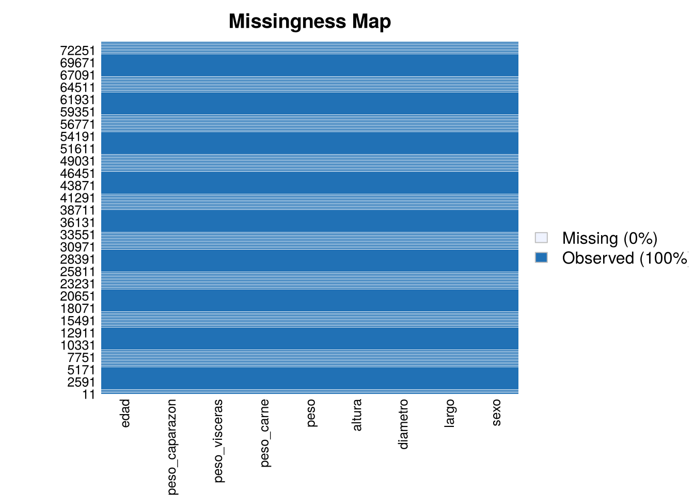
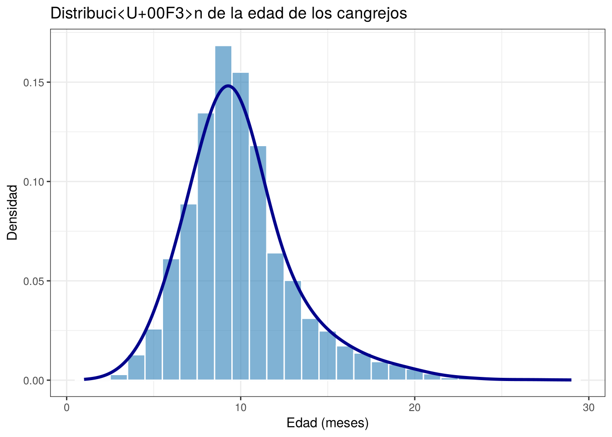
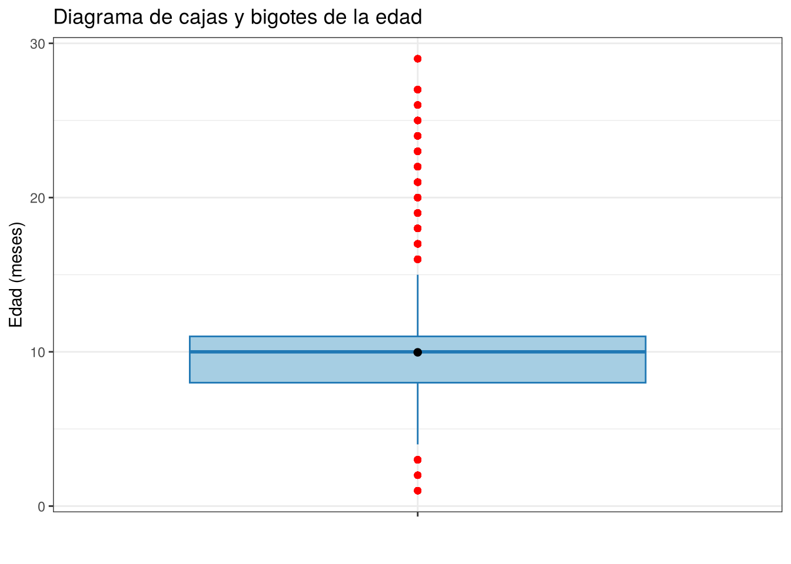
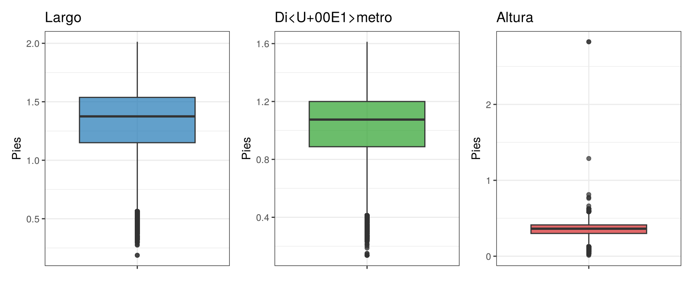
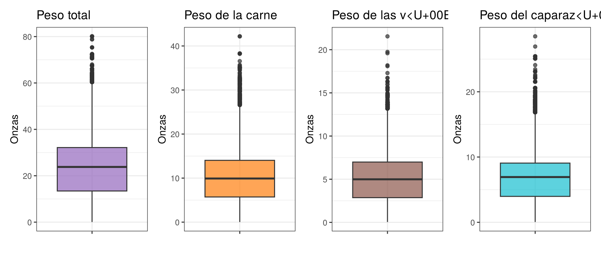
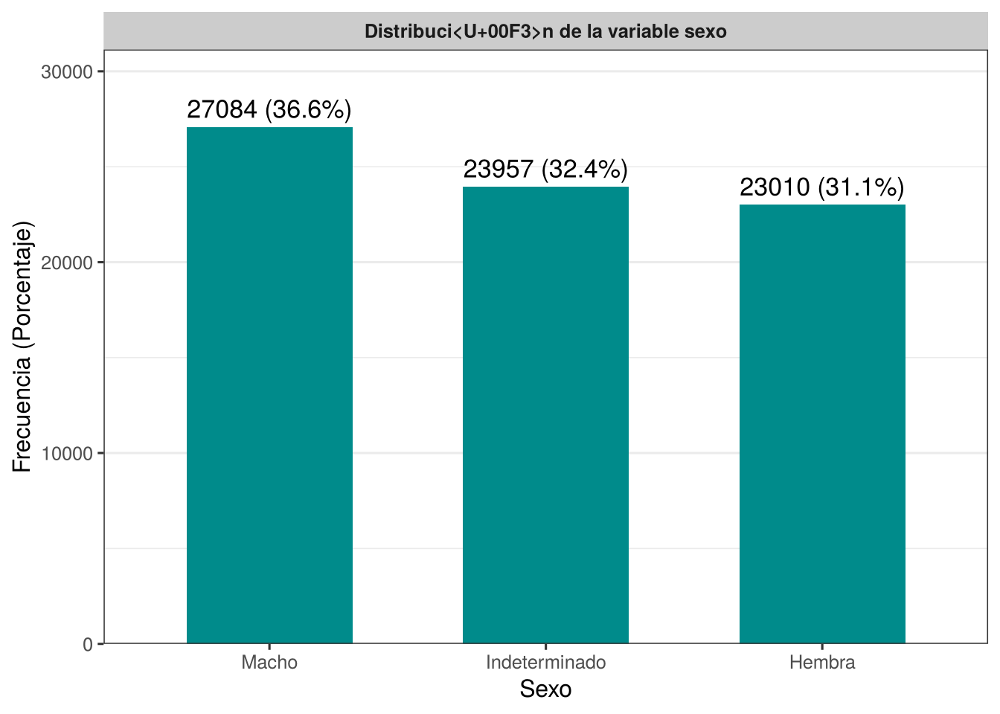
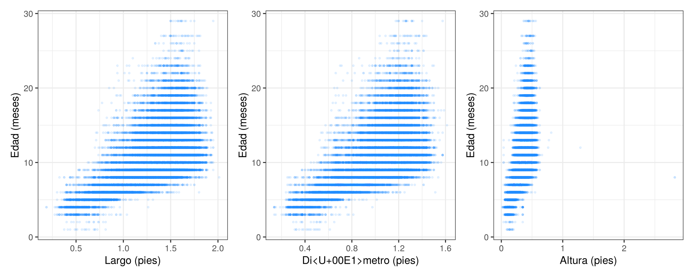
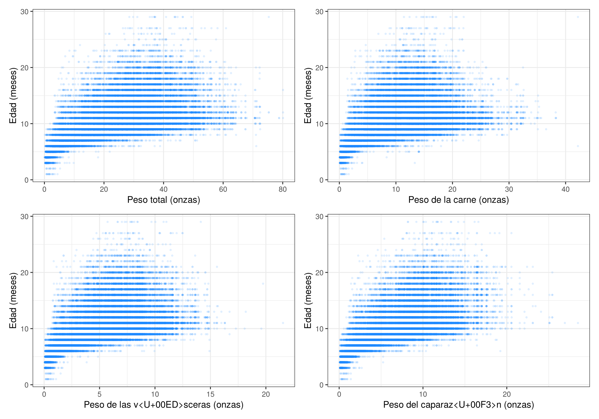
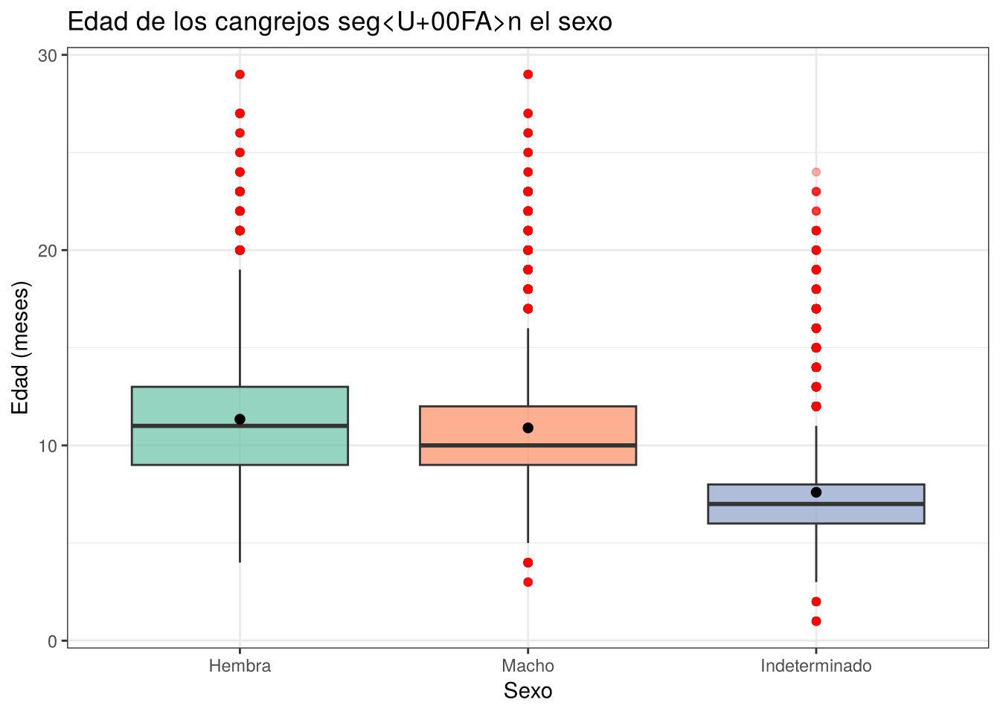
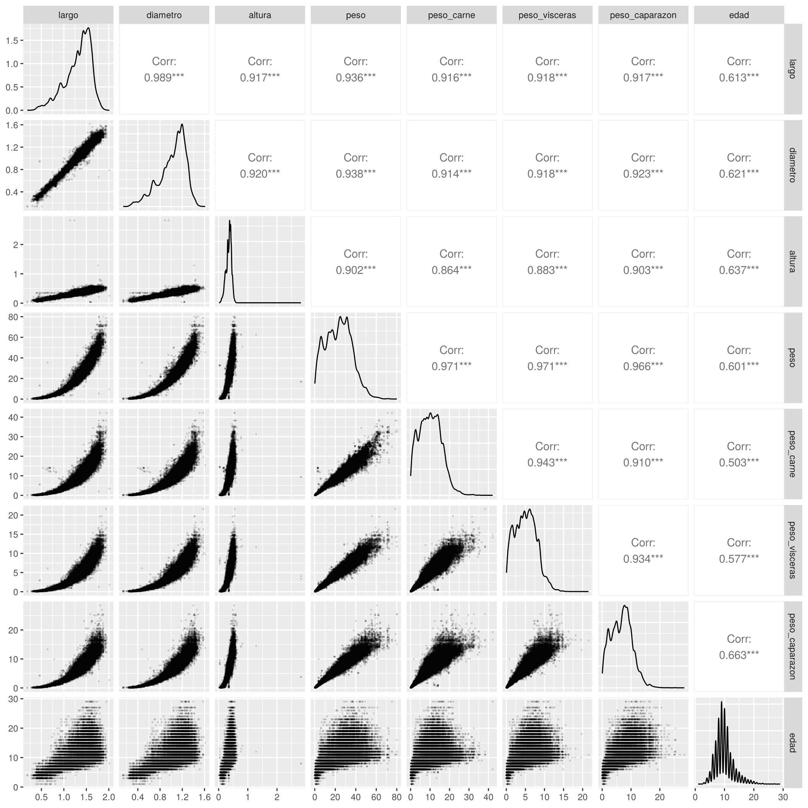

# Análisis exploratorio de datos (EDA) {#eda}

Antes de aplicar cualquier prueba de hipótesis es necesario conocer bien los datos. En este capítulo se hace el análisis exploratorio de la base de cangrejos siguiendo la ruta de las notas de clase para una variable respuesta numérica: primero el contexto de los datos, luego la extracción, transformación y carga (ETL), después el análisis de la variable objetivo, el de las variables características y por último el análisis bivariado.

## Contexto de los datos de cangrejos

El cangrejo es un crustáceo de gran importancia comercial en muchos países. En la cría y pesca de cangrejos conocer la edad del animal es útil para decidir el momento de su captura, ya que después de cierta edad su crecimiento es muy lento y no compensa seguir manteniéndolo. El problema es que la edad no se puede observar directamente, mientras que las medidas físicas del cangrejo sí se obtienen con facilidad. De ahí surge el interés de estudiar la relación entre la edad y esas medidas.

Las variables del conjunto de datos son:

- `id`: identificador de cada registro.
- `Sex`: sexo del cangrejo. Toma los valores `F` (hembra), `M` (macho) e `I` (indeterminado).
- `Length`: largo del cangrejo (en pies).
- `Diameter`: diámetro del cangrejo (en pies).
- `Height`: altura del cangrejo (en pies).
- `Weight`: peso total del cangrejo (en onzas).
- `Shucked Weight`: peso de la carne, es decir, sin el caparazón (en onzas).
- `Viscera Weight`: peso de las vísceras (en onzas).
- `Shell Weight`: peso del caparazón (en onzas).
- `Age`: edad del cangrejo (en meses).

Las unidades corresponden a las indicadas en la descripción del conjunto original *Crab Age Prediction*. La variable objetivo es la edad (`Age`). En este capítulo se busca entender su comportamiento, identificar valores atípicos o inconsistentes y ver qué variables parecen estar más relacionadas con ella.

## Extracción, transformación y carga (ETL)

Carguemos las librerías y el conjunto de datos:


```r
library(tidyverse)

datos <- read.csv("datos/train.csv")
```

Verifiquemos que leímos bien los datos viendo el encabezado y la cola de los datos:


```r
head(datos, n = 5)
```

```
##   id Sex Length Diameter Height   Weight Shucked.Weight Viscera.Weight
## 1  0   I 1.5250   1.1750 0.3750 28.97319      12.728926       6.647958
## 2  1   I 1.1000   0.8250 0.2750 10.41844       4.521745       2.324659
## 3  2   M 1.3875   1.1125 0.3750 24.77746      11.339800       5.556502
## 4  3   F 1.7000   1.4125 0.5000 50.66056      20.354941      10.991839
## 5  4   I 1.2500   1.0125 0.3375 23.28911      11.977664       4.507570
##   Shell.Weight Age
## 1     8.348928   9
## 2     3.401940   8
## 3     6.662133   9
## 4    14.996885  11
## 5     5.953395   8
```


```r
tail(datos, n = 5)
```

```
##          id Sex Length Diameter Height    Weight Shucked.Weight Viscera.Weight
## 74047 74046   F 1.6625   1.2625 0.4375 50.660556      20.680960      10.361742
## 74048 74047   I 1.0750   0.8625 0.2750 10.446791       4.323299       2.296310
## 74049 74048   F 1.4875   1.2000 0.4125 29.483480      12.303683       7.540967
## 74050 74049   I 1.2125   0.9625 0.3125 16.768729       8.972617       2.919999
## 74051 74050   I 0.9125   0.6750 0.2000  5.386405       2.055339       1.034757
##       Shell.Weight Age
## 74047    12.332033  10
## 74048     3.543687   6
## 74049     8.079607  10
## 74050     4.280774   8
## 74051     1.700970   6
```

Las dimensiones, los nombres de las columnas y la estructura de la base de datos se obtienen con los códigos:


```r
dim(datos)
```

```
## [1] 74051    10
```


```r
colnames(datos)
```

```
##  [1] "id"             "Sex"            "Length"         "Diameter"      
##  [5] "Height"         "Weight"         "Shucked.Weight" "Viscera.Weight"
##  [9] "Shell.Weight"   "Age"
```


```r
str(datos)
```

```
## 'data.frame':	74051 obs. of  10 variables:
##  $ id            : int  0 1 2 3 4 5 6 7 8 9 ...
##  $ Sex           : chr  "I" "I" "M" "F" ...
##  $ Length        : num  1.52 1.1 1.39 1.7 1.25 ...
##  $ Diameter      : num  1.175 0.825 1.113 1.413 1.012 ...
##  $ Height        : num  0.375 0.275 0.375 0.5 0.338 ...
##  $ Weight        : num  29 10.4 24.8 50.7 23.3 ...
##  $ Shucked.Weight: num  12.73 4.52 11.34 20.35 11.98 ...
##  $ Viscera.Weight: num  6.65 2.32 5.56 10.99 4.51 ...
##  $ Shell.Weight  : num  8.35 3.4 6.66 15 5.95 ...
##  $ Age           : int  9 8 9 11 8 10 11 11 12 11 ...
```

La base tiene $74.051$ registros y $10$ variables. La función `read.csv()` cambió los espacios de los nombres por puntos (por ejemplo, `Shucked Weight` quedó como `Shucked.Weight`). Para trabajar más cómodos quitamos el identificador, que no aporta información para el análisis, y renombramos las columnas en español:


```r
df <- datos %>%
  select(-id) %>%
  rename(
    sexo           = Sex,
    largo          = Length,
    diametro       = Diameter,
    altura         = Height,
    peso           = Weight,
    peso_carne     = Shucked.Weight,
    peso_visceras  = Viscera.Weight,
    peso_caparazon = Shell.Weight,
    edad           = Age
  )

head(df)
```

```
##   sexo  largo diametro altura     peso peso_carne peso_visceras peso_caparazon
## 1    I 1.5250   1.1750 0.3750 28.97319  12.728926      6.647958       8.348928
## 2    I 1.1000   0.8250 0.2750 10.41844   4.521745      2.324659       3.401940
## 3    M 1.3875   1.1125 0.3750 24.77746  11.339800      5.556502       6.662133
## 4    F 1.7000   1.4125 0.5000 50.66056  20.354941     10.991839      14.996885
## 5    I 1.2500   1.0125 0.3375 23.28911  11.977664      4.507570       5.953395
## 6    M 1.5000   1.1750 0.4125 28.84562  13.409313      6.789705       7.937860
##   edad
## 1    9
## 2    8
## 3    9
## 4   11
## 5    8
## 6   10
```

Identifiquemos los valores NA por columna:


```r
df %>%
  summarise(across(everything(), ~ sum(is.na(.)), .names = "NA_{.col}"))
```

```
##   NA_sexo NA_largo NA_diametro NA_altura NA_peso NA_peso_carne NA_peso_visceras
## 1       0        0           0         0       0             0                0
##   NA_peso_caparazon NA_edad
## 1                 0       0
```

Otra forma de hacerlo es:


```r
library(Amelia)

missmap(df)
```

<div class="figure" style="text-align: center">

<p class="caption">(\#fig:unnamed-chunk-9)Mapa de valores ausentes de la base de cangrejos</p>
</div>

La base no tiene valores ausentes. Sin embargo, que no haya NA no significa que todos los valores tengan sentido. Revisemos si alguna medida física toma el valor cero, lo cual no es posible en un cangrejo real:


```r
df %>%
  summarise(across(where(is.numeric), ~ sum(. == 0), .names = "ceros_{.col}"))
```

```
##   ceros_largo ceros_diametro ceros_altura ceros_peso ceros_peso_carne
## 1           0              0           24          0                0
##   ceros_peso_visceras ceros_peso_caparazon ceros_edad
## 1                   0                    0          0
```

Hay $24$ cangrejos con altura igual a cero. Estos valores son errores de registro, así que los convertimos en NA y, al igual que se hace en las notas de clase con los valores ausentes, los llenamos con el promedio:


```r
df <- df %>%
  mutate(altura = ifelse(altura == 0, NA, altura))

df <- df %>%
  mutate(
    across(
      where(is.numeric),
      ~ ifelse(is.na(.), mean(., na.rm = TRUE), .)
    )
  )
```

Verifiquemos que ya no quedan ceros ni NA en la altura:


```r
df %>%
  summarise(
    NA_altura = sum(is.na(altura)),
    ceros_altura = sum(altura == 0)
  )
```

```
##   NA_altura ceros_altura
## 1         0            0
```

Por último, convertimos el sexo en factor y le ponemos etiquetas más claras:


```r
df <- df %>%
  mutate(
    sexo = factor(sexo,
                  levels = c("F", "M", "I"),
                  labels = c("Hembra", "Macho", "Indeterminado"))
  )

str(df)
```

```
## 'data.frame':	74051 obs. of  9 variables:
##  $ sexo          : Factor w/ 3 levels "Hembra","Macho",..: 3 3 2 1 3 2 2 3 1 2 ...
##  $ largo         : num  1.52 1.1 1.39 1.7 1.25 ...
##  $ diametro      : num  1.175 0.825 1.113 1.413 1.012 ...
##  $ altura        : num  0.375 0.275 0.375 0.5 0.338 ...
##  $ peso          : num  29 10.4 24.8 50.7 23.3 ...
##  $ peso_carne    : num  12.73 4.52 11.34 20.35 11.98 ...
##  $ peso_visceras : num  6.65 2.32 5.56 10.99 4.51 ...
##  $ peso_caparazon: num  8.35 3.4 6.66 15 5.95 ...
##  $ edad          : int  9 8 9 11 8 10 11 11 12 11 ...
```

## Análisis de la variable `edad` (Target)

Consideremos el resumen estadístico de la variable objetivo `edad`, que representa la edad en meses de cada cangrejo:


```r
df %>%
  summarise(
    n = length(edad),
    media = mean(edad),
    ds = sd(edad),
    mediana = median(edad),
    minimo = min(edad),
    maximo = max(edad),
    Q1 = quantile(edad, 0.25),
    Q3 = quantile(edad, 0.75),
    IQR = IQR(edad)
  )
```

```
##       n    media       ds mediana minimo maximo Q1 Q3 IQR
## 1 74051 9.967806 3.175189      10      1     29  8 11   3
```

La variable `edad` fue analizada en $74.051$ cangrejos. La edad promedio es de aproximadamente $9{,}97$ meses ($DS = 3{,}18$ meses) y el $50\%$ de los cangrejos tiene $10$ meses o menos. La edad mínima registrada es de $1$ mes y la máxima de $29$ meses, lo que muestra un rango bastante amplio.

El rango intercuartílico indica que el $50\%$ central de los cangrejos tiene entre $8$ y $11$ meses, con una amplitud de apenas $3$ meses. Es decir, la mayoría de los cangrejos se concentra en un intervalo de edad corto, mientras que unos pocos alcanzan edades mucho mayores. Como la media y la mediana son muy parecidas, la asimetría no se nota en estas dos medidas, pero la distancia entre el tercer cuartil ($11$) y el máximo ($29$) sugiere una cola larga hacia la derecha.

Veamos un histograma


```r
df %>%
  ggplot(aes(x = edad)) +
  geom_histogram(aes(y = after_stat(density)),
                 binwidth = 1,
                 fill = "#2c7fb8",
                 color = "white",
                 alpha = 0.6) +
  geom_density(color = "darkblue", linewidth = 1.2, adjust = 5) +
  labs(
    title = "Distribución de la edad de los cangrejos",
    x = "Edad (meses)",
    y = "Densidad"
  ) +
  theme_bw()
```

<div class="figure" style="text-align: center">

<p class="caption">(\#fig:unnamed-chunk-15)Distribuci<U+00F3>n de la edad de los cangrejos</p>
</div>

Veamos un diagrama de cajas y bigotes


```r
df %>%
  ggplot(aes(x = "", y = edad)) +
  geom_boxplot(fill = "#a6cee3", color = "#1f78b4", outlier.color = "red") +
  stat_summary(
    fun = mean,
    geom = "point",
    shape = 20,
    size = 3,
    color = "black"
  ) +
  labs(
    title = "Diagrama de cajas y bigotes de la edad",
    x = "",
    y = "Edad (meses)"
  ) +
  theme_bw()
```

<div class="figure" style="text-align: center">

<p class="caption">(\#fig:unnamed-chunk-16)Diagrama de cajas y bigotes de la edad de los cangrejos</p>
</div>

Contemos cuántos valores atípicos tiene la edad según el criterio del rango intercuartílico:


```r
Q1 <- quantile(df$edad, 0.25)
Q3 <- quantile(df$edad, 0.75)
RIC <- IQR(df$edad)

tibble(
  limite_inferior = Q1 - 1.5 * RIC,
  limite_superior = Q3 + 1.5 * RIC,
  atipicos = sum(df$edad < Q1 - 1.5 * RIC | df$edad > Q3 + 1.5 * RIC)
)
```

```
## # A tibble: 1 x 3
##   limite_inferior limite_superior atipicos
##             <dbl>           <dbl>    <int>
## 1             3.5            15.5     4811
```

La distribución de la edad presenta una asimetría positiva: la mayor parte de los cangrejos tiene entre $6$ y $13$ meses, con el pico entre los $9$ y $10$ meses, y a partir de ahí la frecuencia baja de forma gradual hasta llegar a los $29$ meses. El diagrama de cajas muestra muchos valores atípicos en ambos extremos, pero sobre todo en el superior. En total hay $4.811$ cangrejos con edades por fuera del intervalo $[3{,}5;\ 15{,}5]$ meses. Estos valores no son errores, porque es normal que algunos cangrejos vivan más que el resto, así que se mantienen en la base.

También se observa que la edad solo toma valores enteros, lo que genera muchos empates. Esto hay que tenerlo en cuenta más adelante, ya que las pruebas basadas en rangos y la prueba de Kolmogorov-Smirnov se ven afectadas por los empates.

## Análisis de las variables características (independientes)

Analizaremos inicialmente las variables numéricas


```r
resumen_numericas <- df %>%
  select(where(is.numeric), -edad) %>%
  pivot_longer(
    cols = everything(),
    names_to = "variable",
    values_to = "valor"
  ) %>%
  group_by(variable) %>%
  summarise(
    n = sum(!is.na(valor)),
    media = mean(valor, na.rm = TRUE),
    ds = sd(valor, na.rm = TRUE),
    mediana = median(valor, na.rm = TRUE),
    minimo = min(valor, na.rm = TRUE),
    maximo = max(valor, na.rm = TRUE),
    Q1 = quantile(valor, 0.25, na.rm = TRUE),
    Q3 = quantile(valor, 0.75, na.rm = TRUE),
    IQR = IQR(valor, na.rm = TRUE),
    .groups = "drop"
  )

resumen_numericas %>%
  mutate(across(where(is.numeric), ~ round(., 4))) %>%
  as.data.frame()
```

```
##         variable     n   media      ds mediana minimo  maximo      Q1      Q3
## 1         altura 74051  0.3482  0.0918  0.3625 0.0125  2.8250  0.3000  0.4125
## 2       diametro 74051  1.0245  0.2374  1.0750 0.1375  1.6125  0.8875  1.2000
## 3          largo 74051  1.3175  0.2878  1.3750 0.1875  2.0128  1.1500  1.5375
## 4           peso 74051 23.3852 12.6482 23.7994 0.0567 80.1015 13.4377 32.1625
## 5 peso_caparazon 74051  6.7239  3.5844  6.9315 0.0425 28.4912  3.9689  9.0718
## 6     peso_carne 74051 10.1043  5.6180  9.9082 0.0283 42.1841  5.7124 14.0330
## 7  peso_visceras 74051  5.0584  2.7927  4.9895 0.0425 21.5456  2.8633  6.9882
##       IQR
## 1  0.1125
## 2  0.3125
## 3  0.3875
## 4 18.7248
## 5  5.1029
## 6  8.3206
## 7  4.1249
```

Las medidas del caparazón se encuentran en escalas parecidas. El largo tiene una media de $1{,}32$ pies ($DS = 0{,}29$) y el diámetro una media de $1{,}02$ pies ($DS = 0{,}24$), mientras que la altura es bastante menor, con una media de $0{,}35$ pies ($DS = 0{,}09$). En las tres medidas la mediana es un poco mayor que la media, lo que indica una ligera asimetría negativa, es decir, hay algunos cangrejos muy pequeños que jalan el promedio hacia abajo. La altura llama la atención porque su máximo es de $2{,}83$ pies, un valor que está muy lejos del tercer cuartil ($0{,}41$) y que incluso supera el largo máximo de la base, por lo que probablemente se trata de un error de medición.

En cuanto a los pesos, el peso total tiene una media de $23{,}39$ onzas ($DS = 12{,}65$) y va desde $0{,}06$ hasta $80{,}10$ onzas. Le siguen el peso de la carne (media de $10{,}10$ onzas), el peso del caparazón (media de $6{,}72$ onzas) y el peso de las vísceras (media de $5{,}06$ onzas). Todos los pesos tienen una desviación estándar grande en relación con su media, lo que refleja la diferencia de tamaño entre cangrejos jóvenes y adultos.


```r
library(patchwork)

# Boxplot del largo
p1 <- df %>%
  ggplot(aes(x = "", y = largo)) +
  geom_boxplot(fill = "#1f77b4", alpha = 0.7) +
  labs(
    title = "Largo",
    y = "Pies",
    x = ""
  ) +
  theme_bw()

# Boxplot del diámetro
p2 <- df %>%
  ggplot(aes(x = "", y = diametro)) +
  geom_boxplot(fill = "#2ca02c", alpha = 0.7) +
  labs(
    title = "Diámetro",
    y = "Pies",
    x = ""
  ) +
  theme_bw()

# Boxplot de la altura
p3 <- df %>%
  ggplot(aes(x = "", y = altura)) +
  geom_boxplot(fill = "#d62728", alpha = 0.7) +
  labs(
    title = "Altura",
    y = "Pies",
    x = ""
  ) +
  theme_bw()

# Primera fila
p1 + p2 + p3
```

<div class="figure" style="text-align: center">

<p class="caption">(\#fig:unnamed-chunk-19)Diagramas de cajas de las medidas del caparaz<U+00F3>n</p>
</div>


```r
# Boxplot del peso total
p4 <- df %>%
  ggplot(aes(x = "", y = peso)) +
  geom_boxplot(fill = "#9467bd", alpha = 0.7) +
  labs(
    title = "Peso total",
    y = "Onzas",
    x = ""
  ) +
  theme_bw()

# Boxplot del peso de la carne
p5 <- df %>%
  ggplot(aes(x = "", y = peso_carne)) +
  geom_boxplot(fill = "#ff7f0e", alpha = 0.7) +
  labs(
    title = "Peso de la carne",
    y = "Onzas",
    x = ""
  ) +
  theme_bw()

# Boxplot del peso de las vísceras
p6 <- df %>%
  ggplot(aes(x = "", y = peso_visceras)) +
  geom_boxplot(fill = "#8c564b", alpha = 0.7) +
  labs(
    title = "Peso de las vísceras",
    y = "Onzas",
    x = ""
  ) +
  theme_bw()

# Boxplot del peso del caparazón
p7 <- df %>%
  ggplot(aes(x = "", y = peso_caparazon)) +
  geom_boxplot(fill = "#17becf", alpha = 0.7) +
  labs(
    title = "Peso del caparazón",
    y = "Onzas",
    x = ""
  ) +
  theme_bw()

# Segunda fila
p4 + p5 + p6 + p7 + plot_layout(nrow = 1)
```

<div class="figure" style="text-align: center">

<p class="caption">(\#fig:unnamed-chunk-20)Diagramas de cajas de los pesos</p>
</div>

Contemos los valores atípicos de cada variable con el mismo criterio del rango intercuartílico:


```r
df %>%
  select(where(is.numeric), -edad) %>%
  summarise(
    across(
      everything(),
      ~ sum(. < quantile(., 0.25) - 1.5 * IQR(.) | . > quantile(., 0.75) + 1.5 * IQR(.))
    )
  )
```

```
##   largo diametro altura peso peso_carne peso_visceras peso_caparazon
## 1  1270     1278   1226  249        311           283            397
```

En las medidas del caparazón (largo, diámetro y altura) los valores atípicos se ubican principalmente en el extremo inferior, con más de $1.200$ casos en cada una. Esto coincide con la asimetría negativa que se veía en la tabla: son cangrejos muy pequeños que se alejan del resto. En la altura, además, aparecen unos pocos valores extremos en la parte de arriba, entre ellos los dos registros de $2{,}83$ pies. En los pesos pasa lo contrario, pues los atípicos están en el extremo superior y son menos (entre $249$ y $397$ casos), correspondientes a cangrejos muy pesados. Como son una proporción pequeña de la base, se conservan para el análisis.

Ahora analizaremos la variable categórica


```r
# Tabla de frecuencias para sexo
tabla_sexo <- df %>%
  count(sexo, name = "Frecuencia") %>%
  mutate(
    Porcentaje = round(Frecuencia / sum(Frecuencia) * 100, 2),
    Variable = "sexo",
    Categoria = as.character(sexo)
  ) %>%
  select(Variable, Categoria, Frecuencia, Porcentaje)

tabla_sexo
```

```
##   Variable     Categoria Frecuencia Porcentaje
## 1     sexo        Hembra      23010      31.07
## 2     sexo         Macho      27084      36.57
## 3     sexo Indeterminado      23957      32.35
```

La variable `sexo` tiene una distribución bastante equilibrada entre sus tres categorías. Los machos son el grupo más numeroso, con el $36{,}57\%$ de los registros, seguidos de los indeterminados con el $32{,}35\%$ y las hembras con el $31{,}07\%$. Ninguna categoría está subrepresentada, así que las comparaciones entre grupos que se hagan en los siguientes capítulos contarán con tamaños de muestra grandes en todos los casos.


```r
tabla_sexo_b <- df %>%
  count(sexo, name = "Frecuencia") %>%
  mutate(
    Porcentaje = round(Frecuencia / sum(Frecuencia) * 100, 1),
    Etiqueta = paste0(Frecuencia, " (", Porcentaje, "%)")
  )

ggplot(tabla_sexo_b, aes(x = reorder(sexo, -Frecuencia), y = Frecuencia)) +
  geom_col(fill = "#008B8B", width = 0.6) +
  geom_text(aes(label = Etiqueta), vjust = -0.5, size = 4.5) +
  facet_wrap(~ "Distribución de la variable sexo") +
  scale_y_continuous(expand = expansion(mult = c(0, 0.15))) +
  labs(
    x = "Sexo",
    y = "Frecuencia (Porcentaje)"
  ) +
  theme_bw(base_size = 12) +
  theme(
    plot.title = element_blank(),
    strip.background = element_rect(fill = "gray80", color = NA),
    strip.text = element_text(face = "bold"),
    panel.grid.major.x = element_blank()
  )
```

<div class="figure" style="text-align: center">

<p class="caption">(\#fig:unnamed-chunk-23)Distribuci<U+00F3>n de la variable sexo</p>
</div>

El gráfico confirma lo anterior: los machos concentran $27.084$ registros ($36{,}6\%$), los indeterminados $23.957$ ($32{,}4\%$) y las hembras $23.010$ ($31{,}1\%$). La diferencia entre la categoría más grande y la más pequeña es de apenas unos cinco puntos porcentuales.

## Análisis exploratorio bivariado

A continuación, analizaremos la relación entre la variable objetivo `edad` y las variables numéricas por medio de diagramas de dispersión. Como la base es muy grande, los puntos se dibujan con transparencia para poder ver dónde se concentran.


```r
# Dispersión de largo vs edad
d1 <- df %>%
  ggplot(aes(x = largo, y = edad)) +
  geom_point(alpha = 0.1, color = "#1E90FF", size = 0.6) +
  labs(
    x = "Largo (pies)",
    y = "Edad (meses)"
  ) +
  theme_bw()

# Dispersión de diámetro vs edad
d2 <- df %>%
  ggplot(aes(x = diametro, y = edad)) +
  geom_point(alpha = 0.1, color = "#1E90FF", size = 0.6) +
  labs(
    x = "Diámetro (pies)",
    y = "Edad (meses)"
  ) +
  theme_bw()

# Dispersión de altura vs edad
d3 <- df %>%
  ggplot(aes(x = altura, y = edad)) +
  geom_point(alpha = 0.1, color = "#1E90FF", size = 0.6) +
  labs(
    x = "Altura (pies)",
    y = "Edad (meses)"
  ) +
  theme_bw()

d1 + d2 + d3
```

<div class="figure" style="text-align: center">

<p class="caption">(\#fig:unnamed-chunk-24)Dispersi<U+00F3>n entre la edad y las medidas del caparaz<U+00F3>n</p>
</div>

En las tres medidas del caparazón se observa una tendencia ascendente: a mayor largo, diámetro o altura, mayor tiende a ser la edad del cangrejo. Sin embargo, la relación no es del todo lineal. Para los cangrejos pequeños la edad aumenta rápido con el tamaño, pero a partir de cierto punto (alrededor de $1{,}5$ pies de largo) la nube de puntos se abre mucho hacia arriba, es decir, cangrejos del mismo tamaño pueden tener edades muy distintas. En el gráfico de la altura se ven claramente los valores atípicos cerca de $2{,}8$ pies, que quedan aislados del resto de los datos y hacen que la mayor parte de la nube se vea comprimida a la izquierda.


```r
# Dispersión de peso total vs edad
d4 <- df %>%
  ggplot(aes(x = peso, y = edad)) +
  geom_point(alpha = 0.1, color = "#1E90FF", size = 0.6) +
  labs(
    x = "Peso total (onzas)",
    y = "Edad (meses)"
  ) +
  theme_bw()

# Dispersión de peso de la carne vs edad
d5 <- df %>%
  ggplot(aes(x = peso_carne, y = edad)) +
  geom_point(alpha = 0.1, color = "#1E90FF", size = 0.6) +
  labs(
    x = "Peso de la carne (onzas)",
    y = "Edad (meses)"
  ) +
  theme_bw()

# Dispersión de peso de las vísceras vs edad
d6 <- df %>%
  ggplot(aes(x = peso_visceras, y = edad)) +
  geom_point(alpha = 0.1, color = "#1E90FF", size = 0.6) +
  labs(
    x = "Peso de las vísceras (onzas)",
    y = "Edad (meses)"
  ) +
  theme_bw()

# Dispersión de peso del caparazón vs edad
d7 <- df %>%
  ggplot(aes(x = peso_caparazon, y = edad)) +
  geom_point(alpha = 0.1, color = "#1E90FF", size = 0.6) +
  labs(
    x = "Peso del caparazón (onzas)",
    y = "Edad (meses)"
  ) +
  theme_bw()

(d4 + d5) / (d6 + d7)
```

<div class="figure" style="text-align: center">

<p class="caption">(\#fig:unnamed-chunk-25)Dispersi<U+00F3>n entre la edad y los pesos</p>
</div>

Con los pesos pasa algo parecido: la edad aumenta a medida que aumenta el peso, pero la dispersión crece para los cangrejos más pesados. El peso del caparazón es el que muestra la tendencia más clara, lo cual tiene sentido porque el caparazón sigue creciendo y endureciéndose con los años. En cambio, en el peso de la carne la nube es más ancha y la tendencia ascendente es menos marcada, lo que sugiere que esta variable está menos asociada con la edad. En todos los casos la forma de la nube es curva, con un crecimiento rápido al principio que después se estabiliza, y la variabilidad de la edad no es constante.

Realizaremos la comparación de la variable objetivo `edad` con respecto a la variable categórica `sexo`, con el fin de evaluar si existen diferencias en la edad de los cangrejos según su sexo.


```r
# Resumen de edad por sexo
sexo_edad <- df %>%
  group_by(sexo) %>%
  summarise(
    n = length(edad),
    media = mean(edad),
    ds = sd(edad),
    mediana = median(edad),
    minimo = min(edad),
    maximo = max(edad),
    Q1 = quantile(edad, 0.25),
    Q3 = quantile(edad, 0.75),
    IQR = IQR(edad),
    .groups = "drop"
  ) %>%
  mutate(
    variable = "sexo",
    niveles = as.character(sexo)
  ) %>%
  select(variable, niveles, everything(), -sexo)

sexo_edad
```

```
## # A tibble: 3 x 11
##   variable niveles         n media    ds mediana minimo maximo    Q1    Q3   IQR
##   <chr>    <chr>       <int> <dbl> <dbl>   <dbl>  <int>  <int> <dbl> <dbl> <dbl>
## 1 sexo     Hembra      23010 11.3   2.96      11      4     29     9    13     4
## 2 sexo     Macho       27084 10.9   2.88      10      3     29     9    12     3
## 3 sexo     Indetermin~ 23957  7.60  2.23       7      1     24     6     8     2
```


```r
df %>%
  ggplot(aes(x = sexo, y = edad, fill = sexo)) +
  geom_boxplot(alpha = 0.7, outlier.color = "red", outlier.alpha = 0.3) +
  stat_summary(
    fun = mean,
    geom = "point",
    shape = 20,
    size = 3,
    color = "black"
  ) +
  scale_fill_brewer(palette = "Set2") +
  labs(
    title = "Edad de los cangrejos según el sexo",
    x = "Sexo",
    y = "Edad (meses)"
  ) +
  theme_bw() +
  theme(legend.position = "none")
```

<div class="figure" style="text-align: center">

<p class="caption">(\#fig:unnamed-chunk-27)Diagrama de cajas de la edad seg<U+00FA>n el sexo</p>
</div>

Se observan diferencias importantes en la edad según el sexo. Las hembras tienen la mayor edad promedio, con $11{,}34$ meses ($DS = 2{,}96$), seguidas muy de cerca por los machos, con $10{,}90$ meses ($DS = 2{,}88$). En cambio, los cangrejos indeterminados tienen una edad promedio mucho menor, de $7{,}60$ meses ($DS = 2{,}23$). La mediana sigue el mismo orden: $11$ meses en las hembras, $10$ en los machos y $7$ en los indeterminados.

Los indeterminados también tienen la menor dispersión, con un rango intercuartílico de apenas $2$ meses (entre $6$ y $8$), frente a $4$ meses en las hembras y $3$ en los machos. Esto tiene sentido si se piensa que la categoría indeterminado agrupa principalmente a cangrejos jóvenes, en los que todavía no se puede identificar el sexo. Por eso esta categoría incluye la edad mínima de la base ($1$ mes). Entre hembras y machos la diferencia es pequeña a simple vista, así que en el siguiente capítulo se verificará con una prueba de hipótesis si esa diferencia es estadísticamente significativa y si tiene importancia práctica.

Por último, usamos la función `ggpairs()` del paquete `GGally` para ver al mismo tiempo las relaciones entre todas las variables numéricas. Este gráfico puede tardar un poco en generarse por el tamaño de la base.


```r
library(GGally)

df %>%
  select(where(is.numeric)) %>%
  ggpairs(
    lower = list(continuous = wrap("points", alpha = 0.1, size = 0.3))
  )
```

<div class="figure" style="text-align: center">

<p class="caption">(\#fig:unnamed-chunk-28)Relaciones entre las variables num<U+00E9>ricas</p>
</div>

La matriz de gráficos muestra que todas las variables físicas están fuertemente relacionadas entre sí. Las correlaciones entre medidas y pesos son todas mayores a $0{,}86$, y entre el largo y el diámetro llega a $0{,}989$, lo que indica que prácticamente miden lo mismo. Los pesos también están muy correlacionados entre ellos (por ejemplo, el peso total y el peso de la carne tienen una correlación de $0{,}971$). Esta alta relación entre las variables independientes es algo que habrá que considerar si más adelante se construye un modelo de regresión con varias de ellas.

Los diagramas de dispersión muestran además que la relación entre las medidas del caparazón y los pesos no es lineal sino curva: el peso crece cada vez más rápido a medida que aumenta el largo, algo razonable si se piensa que el peso depende del volumen del cangrejo.

Frente a la edad, las correlaciones son moderadas, entre $0{,}503$ (peso de la carne) y $0{,}663$ (peso del caparazón). Los diagramas de la última fila confirman que la relación con la edad es positiva pero no perfectamente lineal. En la diagonal se ve que el largo y el diámetro tienen una cola hacia la izquierda (asimetría negativa), mientras que los pesos tienen una forma más achatada con una cola hacia la derecha. La altura aparece con un rango muy amplio por culpa de los dos valores extremos. Estos resultados se analizarán con más detalle en el capítulo \@ref(correglin).
