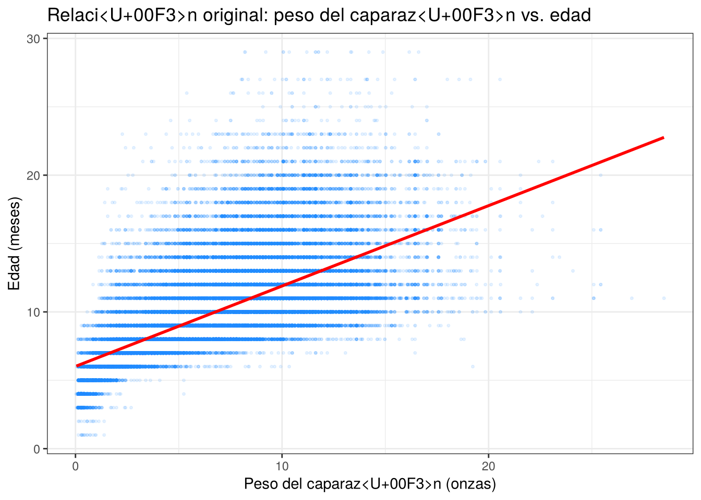
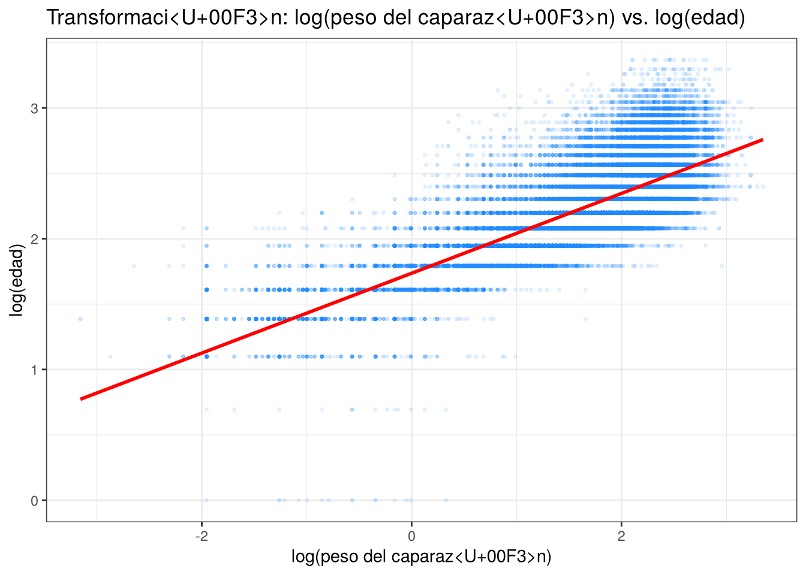
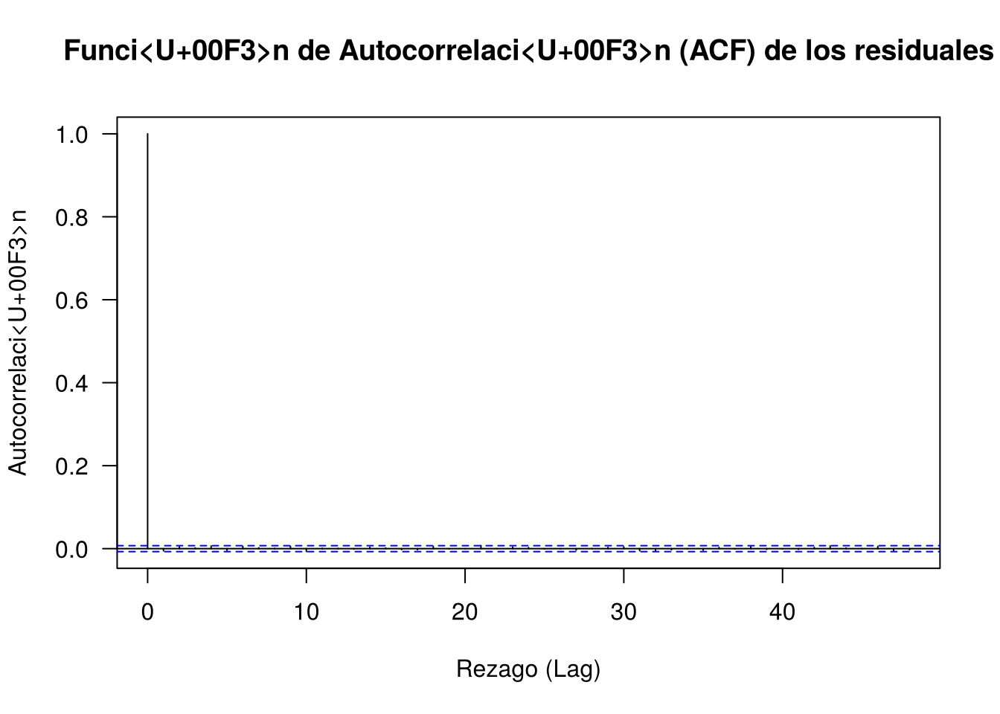
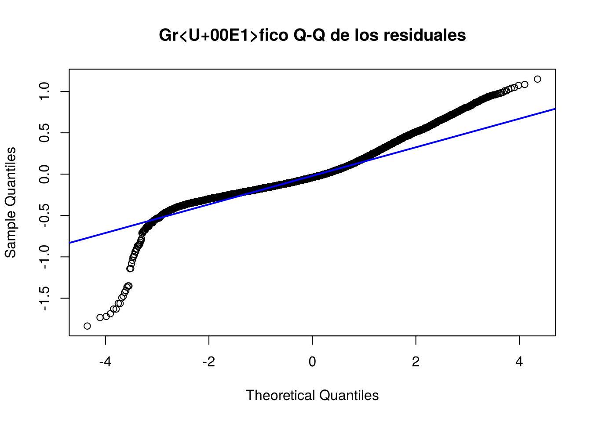
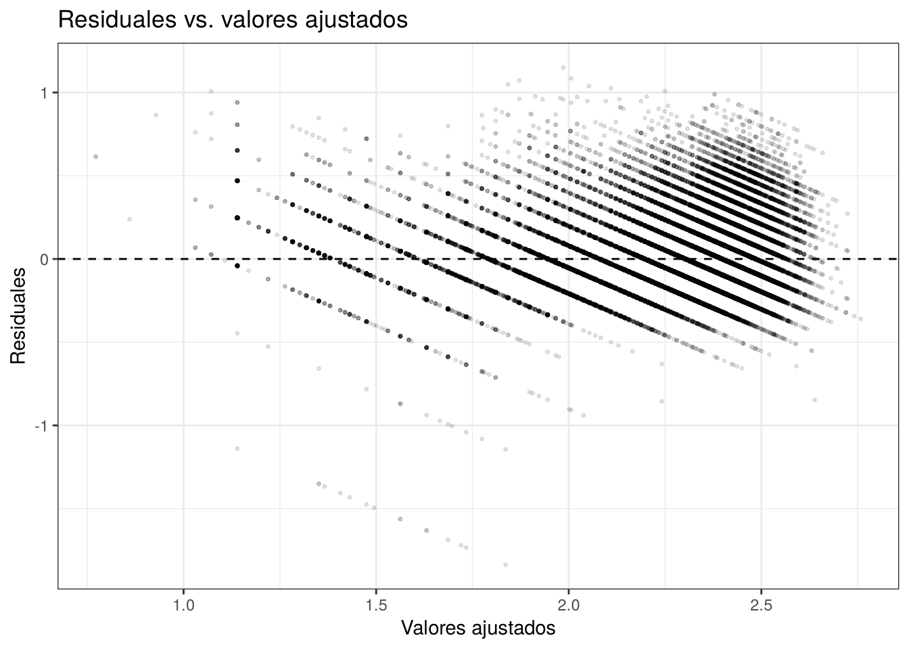

# Regresión lineal simple {#rls}

En el capítulo de correlación se encontró que el peso del caparazón es la medida física más relacionada con la edad de los cangrejos. En este capítulo se construye un modelo de regresión lineal simple (RLS) para explicar la edad a partir del peso del caparazón:

$$
\text{edad}_i = \beta_0 + \beta_1\,\text{peso\_caparazon}_i + \varepsilon_i, \qquad \varepsilon_i \sim N(0, \sigma^2), \qquad \sigma^2 = \text{constante}.
$$

Se trabaja con un nivel de significancia de $\alpha = 0{,}05$. Carguemos las librerías y los datos con la misma limpieza del capítulo \@ref(eda):


```r
library(tidyverse)
library(car)
library(lmtest)
library(nortest)

df <- read.csv("datos/train.csv") %>%
  select(-id) %>%
  rename(
    sexo           = Sex,
    largo          = Length,
    diametro       = Diameter,
    altura         = Height,
    peso           = Weight,
    peso_carne     = Shucked.Weight,
    peso_visceras  = Viscera.Weight,
    peso_caparazon = Shell.Weight,
    edad           = Age
  ) %>%
  mutate(
    altura = ifelse(altura == 0, NA, altura),
    altura = ifelse(is.na(altura), mean(altura, na.rm = TRUE), altura)
  )
```

El diagrama de dispersión entre la edad y el peso del caparazón ya se presentó en el capítulo \@ref(correglin): la edad aumenta con el peso del caparazón, aunque la nube de puntos se abre a medida que el peso crece.

## Estimación de los parámetros por mínimos cuadrados

Los estimadores de mínimos cuadrados son

$$
\hat{\beta}_1 = \frac{S_{xy}}{S_{xx}}, \qquad \hat{\beta}_0 = \bar{y} - \hat{\beta}_1 \bar{x},
$$

donde $S_{xx} = \sum (x_i - \bar{x})^2$ y $S_{xy} = \sum (x_i - \bar{x})(y_i - \bar{y})$. Hagamos el cálculo paso a paso:


```r
# Variables
Y <- df$edad
X <- df$peso_caparazon
n <- length(X)

# Medias
x_bar <- mean(X)
y_bar <- mean(Y)

# Cálculo de Sxx y Sxy
Sxx <- sum((X - x_bar)^2)
Sxy <- sum((X - x_bar) * (Y - y_bar))

# Estimadores de mínimos cuadrados
beta1 <- Sxy / Sxx
beta1
```

```
## [1] 0.5877328
```

```r
beta0 <- y_bar - beta1 * x_bar
beta0
```

```
## [1] 6.015967
```

Con la función `lm()`:


```r
modelo <- lm(edad ~ peso_caparazon, data = df)
modelo
```

```
## 
## Call:
## lm(formula = edad ~ peso_caparazon, data = df)
## 
## Coefficients:
##    (Intercept)  peso_caparazon  
##         6.0160          0.5877
```

El modelo ajustado es

$$
\widehat{\text{edad}}_i = 6{,}016 + 0{,}588\,\text{peso\_caparazon}_i.
$$

- $\hat{\beta}_1 = 0{,}588$: por cada onza adicional de peso del caparazón, la edad promedio del cangrejo aumenta aproximadamente $0{,}59$ meses.
- $\hat{\beta}_0 = 6{,}016$: es la edad promedio estimada para un cangrejo con peso del caparazón igual a cero. Es solo un valor de referencia, porque no hay cangrejos con ese peso.

## Estimación de $\sigma^2$

El estimador insesgado de $\sigma^2$ es el cuadrado medio residual:

$$
\hat{\sigma}^2 = MSE = \frac{SSE}{n - 2}.
$$


```r
# Coeficientes del modelo
b0 <- modelo$coefficients[1]
b1 <- modelo$coefficients[2]

# Ajustados y residuos
yhat <- b0 + b1 * X
e    <- Y - yhat

# SSE por definición
SSE <- sum(e^2)

# MSE y RSE
gl  <- n - 2
MSE <- SSE / gl
MSE
```

```
## [1] 5.643915
```

```r
RSE <- sqrt(MSE)
RSE
```

```
## [1] 2.375693
```

Con la función `lm()`:


```r
summary(modelo)$sigma
```

```
## [1] 2.375693
```

Por lo tanto, $\hat{\sigma} = 2{,}376$ meses y $MSE = 5{,}644$.

## Coeficiente de determinación


```r
# Valores ajustados
Y_hat <- beta0 + beta1 * X

# Sumas de cuadrados
SST <- sum((Y - y_bar)^2)
SSE <- sum((Y - Y_hat)^2)
SSR <- SST - SSE

# Coeficiente de determinación
R2 <- SSR / SST
R2
```

```
## [1] 0.4401968
```

Otra forma de calcularlo es elevando al cuadrado el coeficiente de correlación de Pearson:


```r
rho_est <- with(df, cor(edad, peso_caparazon))
rho_est^2
```

```
## [1] 0.4401968
```

Y con la función `lm()`:


```r
summary(modelo)$r.squared
```

```
## [1] 0.4401968
```

El peso del caparazón explica el $44{,}02\%$ de la variabilidad de la edad de los cangrejos.

## Intervalos de confianza y pruebas de hipótesis para $\beta_0$, $\beta_1$ y $\sigma^2$

### Intervalo de confianza para $\sigma^2$

$$
\frac{(n-2)\hat{\sigma}^2}{\chi^2_{1-\alpha/2,\,n-2}} < \sigma^2 < \frac{(n-2)\hat{\sigma}^2}{\chi^2_{\alpha/2,\,n-2}}
$$


```r
alpha <- 0.05
sigma <- summary(modelo)$sigma
gl <- n - 2
lim_inf <- gl * sigma^2 / qchisq(1 - alpha/2, gl)
lim_sup <- gl * sigma^2 / qchisq(alpha/2, gl)
c(lim_inf = lim_inf, sigma2_hat = sigma^2, lim_sup = lim_sup)
```

```
##    lim_inf sigma2_hat    lim_sup 
##   5.586864   5.643915   5.701848
```

Con una confianza del $95\%$, $\sigma^2 \in (5{,}587;\ 5{,}702)$. Como el cero no está en el intervalo, $\sigma^2 > 0$ a nivel poblacional.

### Intervalo de confianza y prueba de hipótesis para $\beta_0$

$$
H_0: \beta_0 = 0 \quad \text{vs} \quad H_1: \beta_0 \neq 0
$$


```r
# Sigma estimada
sigma_hat <- summary(modelo)$sigma

# Varianza y error estándar de b0
var_b0 <- sigma_hat^2 * (1/n + (x_bar^2)/Sxx)
se_b0 <- sqrt(var_b0)

# Valor crítico t
t_crit <- qt(1 - alpha/2, df = n - 2)

# Intervalo de confianza
inferior <- b0 - t_crit * se_b0
superior <- b0 + t_crit * se_b0
c(LI = inferior, beta0 = b0, LS = superior)
```

```
##    LI.(Intercept) beta0.(Intercept)    LS.(Intercept) 
##          5.979592          6.015967          6.052341
```

```r
# Prueba de hipótesis
t_calc <- (b0 - 0) / se_b0
p_valor <- 2 * (1 - pt(abs(t_calc), gl))
data.frame(beta0_hat = b0, se_beta0 = se_b0, estadistico_t = t_calc,
           gl = gl, p_value = p_valor)
```

```
##             beta0_hat   se_beta0 estadistico_t    gl p_value
## (Intercept)  6.015967 0.01855862      324.1603 74049       0
```

### Intervalo de confianza y prueba de hipótesis para $\beta_1$

$$
H_0: \beta_1 = 0 \quad \text{vs} \quad H_1: \beta_1 \neq 0
$$


```r
# Varianza y error estándar de b1
var_b1 <- sigma_hat^2 / Sxx
se_b1 <- sqrt(var_b1)

# Intervalo de confianza
inferior <- b1 - t_crit * se_b1
superior <- b1 + t_crit * se_b1
c(LI = inferior, beta1 = b1, LS = superior)
```

```
##    LI.peso_caparazon beta1.peso_caparazon    LS.peso_caparazon 
##            0.5829590            0.5877328            0.5925067
```

```r
# Prueba de hipótesis
t_calc <- (b1 - 0) / se_b1
p_valor <- 2 * (1 - pt(abs(t_calc), gl))
data.frame(beta1_hat = b1, se_beta1 = se_b1, estadistico_t = t_calc,
           gl = gl, p_value = p_valor)
```

```
##                beta1_hat    se_beta1 estadistico_t    gl p_value
## peso_caparazon 0.5877328 0.002435648      241.3045 74049       0
```

Verifiquemos los cálculos con las funciones de R:


```r
coefficients(summary(modelo))
```

```
##                 Estimate  Std. Error  t value Pr(>|t|)
## (Intercept)    6.0159667 0.018558615 324.1603        0
## peso_caparazon 0.5877328 0.002435648 241.3045        0
```

```r
confint.default(modelo)
```

```
##                    2.5 %    97.5 %
## (Intercept)    5.9795925 6.0523409
## peso_caparazon 0.5829591 0.5925066
```

- **Intercepto:** es significativo ($t_{(74049)} = 324{,}16,\ p\text{-valor} < 0{,}001$) y su intervalo de confianza del $95\%$ es $(5{,}98;\ 6{,}05)$, que no contiene el cero.
- **Pendiente:** es significativa ($t_{(74049)} = 241{,}31,\ p\text{-valor} < 0{,}001$) y su intervalo de confianza del $95\%$ es $(0{,}583;\ 0{,}593)$. Como no contiene el cero, el peso del caparazón sí aporta información para explicar la edad.

## ANOVA en regresión lineal

$$
H_0: \beta_1 = 0 \quad \text{vs} \quad H_1: \beta_1 \neq 0
$$


```r
anova(modelo)
```

```
## Analysis of Variance Table
## 
## Response: edad
##                   Df Sum Sq Mean Sq F value    Pr(>F)    
## peso_caparazon     1 328633  328633   58228 < 2.2e-16 ***
## Residuals      74049 417926       6                      
## ---
## Signif. codes:  0 '***' 0.001 '**' 0.01 '*' 0.05 '.' 0.1 ' ' 1
```

Como el $p\text{-valor} < 0{,}001$, se rechaza $H_0$ y el modelo es globalmente significativo ($F_{(1,\ 74049)} = 58228$). El valor de $F$ es mucho mayor que 1, así que la mayor parte de la variabilidad explicada de la edad se debe al peso del caparazón y no a los factores incontrolables.

## Transformaciones para mejorar el ajuste

El modelo explica el $44\%$ de la variabilidad de la edad, pero en el diagrama de dispersión la relación no es del todo lineal: la edad crece rápido cuando el caparazón es liviano y después se aplana, y además la nube se abre hacia arriba. Este patrón sugiere probar una transformación log-log (modelo potencial), una de las transformaciones de las notas de clase.

Visualicemos la relación original:


```r
df %>%
  ggplot(aes(peso_caparazon, edad)) +
  geom_point(alpha = 0.1, color = "#1E90FF", size = 0.6) +
  geom_smooth(method = "lm", se = FALSE, color = "red") +
  labs(title = "Relación original: peso del caparazón vs. edad",
       x = "Peso del caparazón (onzas)", y = "Edad (meses)") +
  theme_bw()
```

<div class="figure" style="text-align: center">

<p class="caption">(\#fig:unnamed-chunk-14)Relaci<U+00F3>n original entre el peso del caparaz<U+00F3>n y la edad</p>
</div>

Ahora con las dos variables en escala logarítmica:


```r
df %>%
  ggplot(aes(log(peso_caparazon), log(edad))) +
  geom_point(alpha = 0.1, color = "#1E90FF", size = 0.6) +
  geom_smooth(method = "lm", se = FALSE, color = "red") +
  labs(title = "Transformación: log(peso del caparazón) vs. log(edad)",
       x = "log(peso del caparazón)", y = "log(edad)") +
  theme_bw()
```

<div class="figure" style="text-align: center">

<p class="caption">(\#fig:unnamed-chunk-15)Relaci<U+00F3>n entre el logaritmo del peso del caparaz<U+00F3>n y el logaritmo de la edad</p>
</div>

Con la transformación, los puntos siguen mejor la recta. Ajustemos el modelo:


```r
modelo2 <- lm(log(edad) ~ log(peso_caparazon), data = df)
summary(modelo2)
```

```
## 
## Call:
## lm(formula = log(edad) ~ log(peso_caparazon), data = df)
## 
## Residuals:
##      Min       1Q   Median       3Q      Max 
## -1.83621 -0.13644 -0.03991  0.09646  1.14967 
## 
## Coefficients:
##                      Estimate Std. Error t value Pr(>|t|)    
## (Intercept)         1.7358933  0.0017650   983.5   <2e-16 ***
## log(peso_caparazon) 0.3052096  0.0009485   321.8   <2e-16 ***
## ---
## Signif. codes:  0 '***' 0.001 '**' 0.01 '*' 0.05 '.' 0.1 ' ' 1
## 
## Residual standard error: 0.2026 on 74049 degrees of freedom
## Multiple R-squared:  0.5831,	Adjusted R-squared:  0.5831 
## F-statistic: 1.036e+05 on 1 and 74049 DF,  p-value: < 2.2e-16
```

- La variable `log(peso_caparazon)` es significativa ($p\text{-valor} < 0{,}001$).
- El coeficiente $0{,}305$ indica que, si el peso del caparazón aumenta un $1\%$, la edad aumenta aproximadamente un $0{,}31\%$.
- El $R^2$ sube de $0{,}440$ a $0{,}583$: el modelo transformado explica el $58{,}3\%$ de la variabilidad de la edad.
- El modelo es significativo en su conjunto ($F = 1{,}036 \times 10^{5}$, $p\text{-valor} < 0{,}001$).

Como el modelo transformado ajusta mejor, es el que se usa en el resto del capítulo:

$$
\widehat{\log(\text{edad})}_i = 1{,}736 + 0{,}305\,\log(\text{peso\_caparazon}_i).
$$

## Análisis de residuales

Para usar el modelo en predicción hay que validar los supuestos de los errores: independencia, normalidad, media cero y varianza constante.

### Independencia de los errores


```r
durbinWatsonTest(modelo2)
```

```
##  lag Autocorrelation D-W Statistic p-value
##    1    -0.005105108      2.010195   0.164
##  Alternative hypothesis: rho != 0
```


```r
r <- residuals(modelo2)
acf(r, main = "Función de Autocorrelación (ACF) de los residuales",
    ylab = "Autocorrelación", xlab = "Rezago (Lag)", las = 1)
```

<div class="figure" style="text-align: center">

<p class="caption">(\#fig:unnamed-chunk-18)Funci<U+00F3>n de autocorrelaci<U+00F3>n de los residuales del modelo transformado</p>
</div>

El $p\text{-valor}$ de la prueba de Durbin-Watson es mayor que $0{,}05$ y las barras de la ACF están dentro de las bandas, así que los errores son independientes.

### Normalidad de los errores

$$
H_0: \text{los errores siguen una distribución normal} \quad \text{vs} \quad H_A: \text{los errores no siguen una distribución normal}
$$

Como hay más de 5.000 residuales, se usa la prueba de Lilliefors en lugar de Shapiro-Wilk:


```r
lillie.test(r)
```

```
## 
## 	Lilliefors (Kolmogorov-Smirnov) normality test
## 
## data:  r
## D = 0.096936, p-value < 2.2e-16
```


```r
qqnorm(r, main = "Gráfico Q-Q de los residuales")
qqline(r, col = "blue", lwd = 2)
```

<div class="figure" style="text-align: center">

<p class="caption">(\#fig:unnamed-chunk-20)Gr<U+00E1>fico Q-Q de los residuales del modelo transformado</p>
</div>

El $p\text{-valor} < 0{,}05$, por lo que se rechaza $H_0$: los errores no siguen una distribución normal. En el gráfico Q-Q los puntos se alejan de la línea en las dos colas.

### Media cero de los errores


```r
mean(r)
```

```
## [1] 1.750472e-17
```

```r
t.test(r, mu = 0)
```

```
## 
## 	One Sample t-test
## 
## data:  r
## t = 2.3508e-14, df = 74050, p-value = 1
## alternative hypothesis: true mean is not equal to 0
## 95 percent confidence interval:
##  -0.001459485  0.001459485
## sample estimates:
##    mean of x 
## 1.750472e-17
```

Como el modelo tiene intercepto, la media de los residuales es cero, y la prueba *t* lo confirma ($p\text{-valor} = 1$).

### Varianza constante de los errores


```r
diag_df <- data.frame(
  Ajustados  = fitted(modelo2),
  Residuales = resid(modelo2)
)

ggplot(diag_df, aes(x = Ajustados, y = Residuales)) +
  geom_point(alpha = 0.1, size = 0.6) +
  geom_hline(yintercept = 0, linetype = "dashed") +
  labs(title = "Residuales vs. valores ajustados",
       x = "Valores ajustados", y = "Residuales") +
  theme_bw()
```

<div class="figure" style="text-align: center">

<p class="caption">(\#fig:unnamed-chunk-22)Residuales vs. valores ajustados del modelo transformado</p>
</div>


```r
bptest(modelo2)
```

```
## 
## 	studentized Breusch-Pagan test
## 
## data:  modelo2
## BP = 9.73, df = 1, p-value = 0.001813
```

El $p\text{-valor}$ de la prueba de Breusch-Pagan es menor que $0{,}05$, así que la varianza de los errores no es constante.

En resumen, el modelo cumple los supuestos de independencia y media cero, pero no los de normalidad y varianza constante. Con 74.051 datos estas pruebas detectan cualquier desviación, por pequeña que sea; aun así, los intervalos que siguen deben leerse con cautela.

## Intervalo de confianza para $E(y \mid x_0)$ e intervalo de predicción

Supongamos que se quiere estimar la edad de los cangrejos cuyo caparazón pesa $x_0 = 7$ onzas, un valor cercano a la mediana de la base. Como el modelo está en escala logarítmica, primero se calculan los intervalos para $\log(\text{edad})$ y luego se retrotransforman con la función exponencial.

Paso a paso, para el intervalo de confianza de la media:


```r
# Variable explicativa transformada
x_log <- log(df$peso_caparazon)
xbar  <- mean(x_log)
Sxx   <- sum((x_log - xbar)^2)
sig   <- summary(modelo2)$sigma
x0    <- log(7)

# Estimación puntual en escala log
b  <- coef(modelo2)
y0 <- unname(b[1] + b[2] * x0)

# Error estándar e intervalo de confianza del 95%
se0   <- sig * sqrt(1/n + (x0 - xbar)^2 / Sxx)
tcrit <- qt(0.975, df = n - 2)
ic_log <- c(y_hat = y0, LI = y0 - tcrit * se0, LS = y0 + tcrit * se0)

# Retrotransformación a meses
exp(ic_log)
```

```
##    y_hat       LI       LS 
## 10.27592 10.26015 10.29173
```

Y para el intervalo de predicción de un cangrejo nuevo:


```r
se_pred <- sig * sqrt(1 + 1/n + (x0 - xbar)^2 / Sxx)
ip_log <- c(y_hat = y0, LI = y0 - tcrit * se_pred, LS = y0 + tcrit * se_pred)
exp(ip_log)
```

```
##     y_hat        LI        LS 
## 10.275924  6.907711 15.286483
```

El mismo resultado se obtiene con `predict()`:


```r
exp(predict(modelo2, newdata = data.frame(peso_caparazon = 7), interval = "confidence"))
```

```
##        fit      lwr      upr
## 1 10.27592 10.26015 10.29173
```

```r
exp(predict(modelo2, newdata = data.frame(peso_caparazon = 7), interval = "prediction"))
```

```
##        fit      lwr      upr
## 1 10.27592 6.907711 15.28648
```

Para los cangrejos con un caparazón de 7 onzas, la edad estimada es de $10{,}28$ meses. Con una confianza del $95\%$, la edad esperada de esos cangrejos está entre $10{,}26$ y $10{,}29$ meses, y la edad de un cangrejo nuevo con ese peso estará entre $6{,}91$ y $15{,}29$ meses. El intervalo de predicción es mucho más ancho porque incluye la variabilidad de cada cangrejo, y eso muestra que con una sola variable la edad no se puede predecir con precisión. En el siguiente capítulo se agregan las demás variables para mejorar el modelo.
