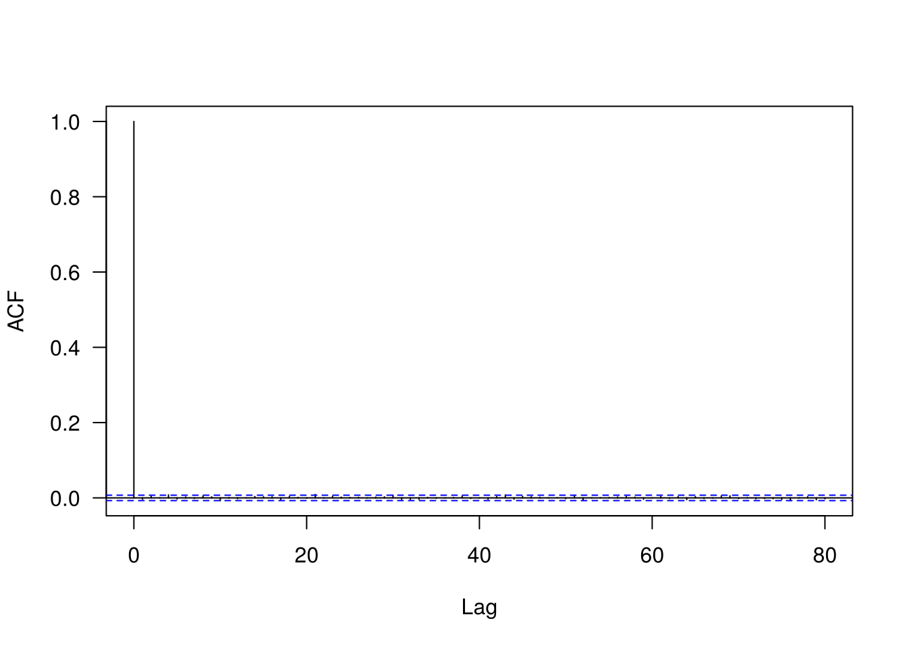
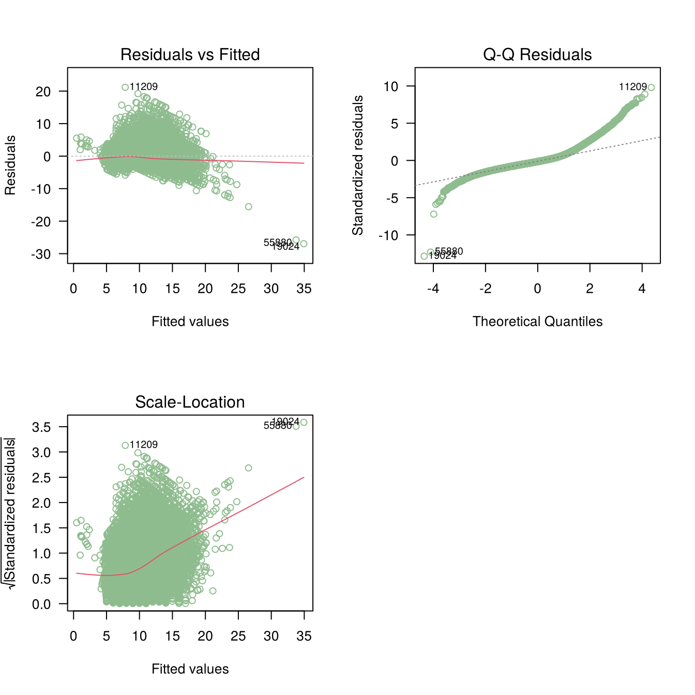

# Regresión lineal múltiple {#rlm}

El modelo de regresión lineal simple del capítulo anterior explica menos del $60\%$ de la variabilidad de la edad, y su intervalo de predicción es muy ancho. En este capítulo se usan varias variables a la vez con un modelo de regresión lineal múltiple (RLM):

$$
\text{edad}_i = \beta_0 + \beta_1 x_{i1} + \beta_2 x_{i2} + \cdots + \beta_k x_{ik} + \varepsilon_i, \qquad \varepsilon_i \sim N(0, \sigma^2), \qquad \sigma^2 = \text{constante}.
$$

Primero se ajusta el modelo con las siete medidas físicas, después se agrega el sexo como variable cualitativa y, por último, se selecciona el mejor modelo y se validan sus supuestos. Se trabaja con $\alpha = 0{,}05$.


```r
library(tidyverse)
library(car)
library(lmtest)
library(nortest)
library(mctest)
library(olsrr)

df <- read.csv("datos/train.csv") %>%
  select(-id) %>%
  rename(
    sexo           = Sex,
    largo          = Length,
    diametro       = Diameter,
    altura         = Height,
    peso           = Weight,
    peso_carne     = Shucked.Weight,
    peso_visceras  = Viscera.Weight,
    peso_caparazon = Shell.Weight,
    edad           = Age
  ) %>%
  mutate(
    altura = ifelse(altura == 0, NA, altura),
    altura = ifelse(is.na(altura), mean(altura, na.rm = TRUE), altura),
    sexo = factor(sexo,
                  levels = c("F", "M", "I"),
                  labels = c("Hembra", "Macho", "Indeterminado"))
  )
```

La red de diagramas de dispersión entre la edad y las medidas físicas ya se presentó en el capítulo \@ref(eda). Allí se vio que todas las medidas tienen una relación positiva con la edad, pero también que están muy correlacionadas entre sí, algo que hay que revisar en este capítulo.

## Modelo con las medidas físicas

### Estimación de los coeficientes

El estimador de mínimos cuadrados es

$$
\hat{\boldsymbol{\beta}} = (\mathbf{X}'\mathbf{X})^{-1}\mathbf{X}'\mathbf{y}.
$$

Hagamos el cálculo paso a paso:


```r
# Matriz de diseño X (con intercepto) y vector y
X = cbind(Intercept = 1, largo = df$largo, diametro = df$diametro,
          altura = df$altura, peso = df$peso, peso_carne = df$peso_carne,
          peso_visceras = df$peso_visceras, peso_caparazon = df$peso_caparazon)
y = as.matrix(df$edad)

# X'X, su inversa y X'y
XtX = t(X) %*% X
XtX_inv = solve(XtX)
Xty = t(X) %*% y

# Estimadores
beta_hat = XtX_inv %*% Xty
beta_hat
```

```
##                      [,1]
## Intercept       2.2588017
## largo           0.8669152
## diametro        2.9390928
## altura          7.7763153
## peso            0.1985124
## peso_carne     -0.6289081
## peso_visceras  -0.1867794
## peso_caparazon  0.5213160
```

Con la función `lm()`:


```r
modelo = lm(edad ~ largo + diametro + altura + peso + peso_carne +
              peso_visceras + peso_caparazon, data = df)
summary(modelo)
```

```
## 
## Call:
## lm(formula = edad ~ largo + diametro + altura + peso + peso_carne + 
##     peso_visceras + peso_caparazon, data = df)
## 
## Residuals:
##      Min       1Q   Median       3Q      Max 
## -18.8742  -1.2417  -0.3770   0.7596  21.7980 
## 
## Coefficients:
##                 Estimate Std. Error t value Pr(>|t|)    
## (Intercept)     2.258802   0.068473  32.988  < 2e-16 ***
## largo           0.866915   0.194682   4.453 8.48e-06 ***
## diametro        2.939093   0.241181  12.186  < 2e-16 ***
## altura          7.776315   0.238457  32.611  < 2e-16 ***
## peso            0.198512   0.005486  36.187  < 2e-16 ***
## peso_carne     -0.628908   0.006706 -93.778  < 2e-16 ***
## peso_visceras  -0.186779   0.012006 -15.557  < 2e-16 ***
## peso_caparazon  0.521316   0.009947  52.411  < 2e-16 ***
## ---
## Signif. codes:  0 '***' 0.001 '**' 0.01 '*' 0.05 '.' 0.1 ' ' 1
## 
## Residual standard error: 2.156 on 74043 degrees of freedom
## Multiple R-squared:  0.539,	Adjusted R-squared:  0.539 
## F-statistic: 1.237e+04 on 7 and 74043 DF,  p-value: < 2.2e-16
```

Los coeficientes calculados paso a paso coinciden con los de `lm()`. Algunos se interpretan así, manteniendo constantes las demás variables:

- $\hat{\beta}_{\text{peso\_caparazon}} = 0{,}521$: por cada onza adicional de peso del caparazón, la edad promedio aumenta $0{,}521$ meses.
- $\hat{\beta}_{\text{peso\_carne}} = -0{,}629$: por cada onza adicional de peso de la carne, la edad promedio disminuye $0{,}63$ meses.

El signo negativo del peso de la carne es extraño, porque en el capítulo \@ref(correglin) todas las medidas tenían una correlación positiva con la edad. Esto es una primera señal de multicolinealidad, que se revisa más adelante.

### Residuales


```r
y_hat = X %*% beta_hat
e = y - y_hat
head(cbind(observado = y[,1], ajustado = y_hat[,1], residuo = e[,1]))
```

```
##      observado  ajustado    residuo
## [1,]         9 10.807342 -1.8073417
## [2,]         8  8.339362 -0.3393620
## [3,]         9  9.869684 -0.8696842
## [4,]        11 14.792614 -3.7926144
## [5,]         8  8.294791 -0.2947914
## [6,]        10 10.383283 -0.3832827
```

```r
residuo = residuals(modelo)
summary(residuo)
```

```
##     Min.  1st Qu.   Median     Mean  3rd Qu.     Max. 
## -18.8742  -1.2417  -0.3770   0.0000   0.7596  21.7980
```

### Estimación de $\sigma^2$

$$
\hat{\sigma}^2 = MSE = \frac{SSE}{n - p}, \qquad SSE = \mathbf{y}'\mathbf{y} - \hat{\boldsymbol{\beta}}'\mathbf{X}'\mathbf{y}
$$


```r
y = df$edad

# Cálculo del SSE
SSE = as.numeric(t(y) %*% y - t(beta_hat) %*% t(X) %*% y)

# MSE y RMSE
n = nrow(X)
p = ncol(X)
MSE = SSE / (n - p)
RMSE = sqrt(MSE)
c(SSE = SSE, MSE = MSE, RMSE = RMSE)
```

```
##          SSE          MSE         RMSE 
## 3.441438e+05 4.647891e+00 2.155897e+00
```

```r
# Sigma del modelo
summary(modelo)$sigma^2
```

```
## [1] 4.647891
```

La varianza estimada de los errores es $\hat{\sigma}^2 = 4{,}648$, es decir, el modelo se equivoca en promedio en unos $2{,}16$ meses.

### Prueba de significancia global

$$
H_0: \beta_1 = \beta_2 = \cdots = \beta_k = 0 \quad \text{vs} \quad H_1: \beta_j \neq 0 \text{ para al menos una } j
$$


```r
SST = as.numeric(t(y) %*% y - (sum(y)^2 / n))
SSR = SST - SSE
deg_reg = p - 1
deg_res = n - p
MSR = SSR / deg_reg
MSE = SSE / deg_res
Fo = MSR / MSE
p_val = pf(Fo, deg_reg, deg_res, lower.tail = FALSE)
c(SSR = SSR, SSE = SSE, SST = SST, Fo = Fo, p_val = p_val)
```

```
##      SSR      SSE      SST       Fo    p_val 
## 402415.5 344143.8 746559.2  12368.6      0.0
```

```r
summary(modelo)$fstatistic
```

```
##   value   numdf   dendf 
## 12368.6     7.0 74043.0
```

Como el $p\text{-valor} < 0{,}001$, se rechaza $H_0$ ($F_{(7,\ 74043)} = 12368{,}6$): al menos una de las medidas físicas ayuda a explicar la edad.

### Prueba individual de significancia

$$
H_0: \beta_j = 0 \quad \text{vs} \quad H_1: \beta_j \neq 0, \qquad t_j = \frac{\hat{\beta}_j}{\sqrt{\hat{\sigma}^2\,(\mathbf{X}'\mathbf{X})^{-1}_{jj}}}
$$


```r
Var_beta_hat = MSE * XtX_inv
se_beta_hat = sqrt(diag(Var_beta_hat))
t_calc = beta_hat / se_beta_hat
p_val = 2 * pt(abs(t_calc), df = deg_res, lower.tail = FALSE)
cbind(beta_hat = beta_hat[,1], se = se_beta_hat, t = t_calc[,1], p_valor = p_val[,1])
```

```
##                  beta_hat          se         t       p_valor
## Intercept       2.2588017 0.068473213  32.98811 6.354338e-237
## largo           0.8669152 0.194682491   4.45297  8.481436e-06
## diametro        2.9390928 0.241180814  12.18626  3.967080e-34
## altura          7.7763153 0.238457211  32.61095 1.269299e-231
## peso            0.1985124 0.005485681  36.18738 2.965285e-284
## peso_carne     -0.6289081 0.006706360 -93.77786  0.000000e+00
## peso_visceras  -0.1867794 0.012006108 -15.55703  1.739428e-54
## peso_caparazon  0.5213160 0.009946636  52.41129  0.000000e+00
```

```r
summary(modelo)$coefficients
```

```
##                  Estimate  Std. Error   t value      Pr(>|t|)
## (Intercept)     2.2588017 0.068473213  32.98811 6.354338e-237
## largo           0.8669152 0.194682491   4.45297  8.481436e-06
## diametro        2.9390928 0.241180814  12.18626  3.967080e-34
## altura          7.7763153 0.238457211  32.61095 1.269299e-231
## peso            0.1985124 0.005485681  36.18738 2.965285e-284
## peso_carne     -0.6289081 0.006706360 -93.77786  0.000000e+00
## peso_visceras  -0.1867794 0.012006108 -15.55703  1.739428e-54
## peso_caparazon  0.5213160 0.009946636  52.41129  0.000000e+00
```

Todos los coeficientes son significativos ($p\text{-valor} < 0{,}001$). Con 74.051 datos esto es de esperarse, así que la significancia individual no basta para decidir qué variables dejar en el modelo.

### Intervalos de confianza para los coeficientes


```r
confint.default(modelo)
```

```
##                     2.5 %     97.5 %
## (Intercept)     2.1245967  2.3930067
## largo           0.4853446  1.2484859
## diametro        2.4663871  3.4117985
## altura          7.3089478  8.2436829
## peso            0.1877607  0.2092642
## peso_carne     -0.6420523 -0.6157639
## peso_visceras  -0.2103109 -0.1632479
## peso_caparazon  0.5018209  0.5408110
```

Ningún intervalo contiene el cero, lo que coincide con las pruebas individuales.

### Coeficiente de determinación y $R^2$ ajustado


```r
R2 = SSR / SST
R2_ajustado = 1 - (SSE / (n - p)) / (SST / (n - 1))
c(R2 = R2, R2_ajustado = R2_ajustado)
```

```
##          R2 R2_ajustado 
##   0.5390268   0.5389833
```

```r
summary(modelo)$r.squared
```

```
## [1] 0.5390268
```

```r
summary(modelo)$adj.r.squared
```

```
## [1] 0.5389833
```

El modelo explica el $53{,}90\%$ de la variabilidad de la edad, bastante más que el $44\%$ del modelo con solo el peso del caparazón.

## Análisis de multicolinealidad

Para revisar si las medidas físicas son redundantes se usan el número de condición (ICN), que indica multicolinealidad si es mayor que 30, y el VIF, que señala a una variable como responsable si es mayor que 5.


```r
kappa(modelo)
```

```
## [1] 690.0005
```

```r
vif(modelo)
```

```
##          largo       diametro         altura           peso     peso_carne 
##      50.000587      52.227889       7.637785      76.698071      22.615714 
##  peso_visceras peso_caparazon 
##      17.911465      20.251062
```


```r
mctest(modelo, type = "b")
```

```
## 
## Call:
## omcdiag(mod = mod, Inter = Inter, detr = detr, red = red, conf = conf, 
##     theil = theil, cn = cn)
## 
## 
## Overall Multicollinearity Diagnostics
## 
##                          MC Results detection
## Determinant |X'X|:           0.0000         1
## Farrar Chi-Square:     1241938.2833         1
## Red Indicator:               0.9269         1
## Sum of Lambda Inverse:     247.3426         1
## Theil's Method:              3.4333         1
## Condition Number:          124.2281         1
## 
## 1 --> COLLINEARITY is detected by the test 
## 0 --> COLLINEARITY is not detected by the test
## 
## 
## ===================================
## 
## Call:
## imcdiag(mod = mod, method = method, corr = FALSE, vif = vif, 
##     tol = tol, conf = conf, cvif = cvif, ind1 = ind1, ind2 = ind2, 
##     leamer = leamer, all = all)
## 
## 
## All Individual Multicollinearity Diagnostics Result
## 
##                    VIF    TOL        Wi         Fi Leamer     CVIF Klein IND1
## largo          50.0006 0.0200 604699.92  725649.70 0.1414 -14.8176     1    0
## diametro       52.2279 0.0191 632186.30  758633.80 0.1384 -15.4777     1    0
## altura          7.6378 0.1309  81914.69   98298.96 0.3618  -2.2634     1    0
## peso           76.6981 0.0130 934164.66 1121012.73 0.1142 -22.7294     1    0
## peso_carne     22.6157 0.0442 266752.32  320107.11 0.2103  -6.7021     1    0
## peso_visceras  17.9115 0.0558 208698.75  250441.89 0.2363  -5.3080     1    0
## peso_caparazon 20.2511 0.0494 237570.94  285088.97 0.2222  -6.0014     1    0
##                  IND2
## largo          1.0289
## diametro       1.0298
## altura         0.9124
## peso           1.0362
## peso_carne     1.0035
## peso_visceras  0.9913
## peso_caparazon 0.9980
## 
## 1 --> COLLINEARITY is detected by the test 
## 0 --> COLLINEARITY is not detected by the test
## 
## * all coefficients have significant t-ratios
## 
## R-square of y on all x: 0.539 
## 
## * use method argument to check which regressors may be the reason of collinearity
## ===================================
```

El ICN es $690$, muy por encima de 30, y seis de las siete medidas tienen un VIF mayor que 5; el más alto es el del peso total ($76{,}7$). Las pruebas globales e individuales de `mctest()` también detectan multicolinealidad. Es decir, las medidas físicas son redundantes: varias contienen casi la misma información, y por eso aparecen signos negativos que no tienen sentido, como el del peso de la carne.

## Modelos con variables cualitativas

El sexo es una variable cualitativa con tres categorías, así que para incluirlo en el modelo se transforma en dos variables dummy, tomando a las hembras como categoría de referencia:

- `sexoMacho` $= 1$ si el cangrejo es macho y $0$ en otro caso.
- `sexoIndeterminado` $= 1$ si el cangrejo es indeterminado y $0$ en otro caso.

| Sexo | `sexoMacho` | `sexoIndeterminado` |
|:---|:---:|:---:|
| Hembra | 0 | 0 |
| Macho | 1 | 0 |
| Indeterminado | 0 | 1 |

En R esta codificación se genera automáticamente porque `sexo` es un factor:


```r
matriz = model.matrix(~ sexo, data = df)
head(cbind(df["sexo"], matriz))
```

```
##            sexo (Intercept) sexoMacho sexoIndeterminado
## 1 Indeterminado           1         0                 1
## 2 Indeterminado           1         0                 1
## 3         Macho           1         1                 0
## 4        Hembra           1         0                 0
## 5 Indeterminado           1         0                 1
## 6         Macho           1         1                 0
```

Calculemos la edad promedio por sexo y ajustemos el modelo de la edad contra el sexo:


```r
df %>%
  group_by(sexo) %>%
  summarise(promedio = mean(edad))
```

```
## # A tibble: 3 x 2
##   sexo          promedio
##   <fct>            <dbl>
## 1 Hembra           11.3 
## 2 Macho            10.9 
## 3 Indeterminado     7.60
```

```r
modelo_sexo = lm(edad ~ sexo, data = df)
summary(modelo_sexo)
```

```
## 
## Call:
## lm(formula = edad ~ sexo, data = df)
## 
## Residuals:
##     Min      1Q  Median      3Q     Max 
## -7.8960 -1.5991 -0.5991  1.1040 18.1040 
## 
## Coefficients:
##                   Estimate Std. Error t value Pr(>|t|)    
## (Intercept)       11.34155    0.01789  633.92   <2e-16 ***
## sexoMacho         -0.44559    0.02433  -18.31   <2e-16 ***
## sexoIndeterminado -3.74247    0.02505 -149.40   <2e-16 ***
## ---
## Signif. codes:  0 '***' 0.001 '**' 0.01 '*' 0.05 '.' 0.1 ' ' 1
## 
## Residual standard error: 2.714 on 74048 degrees of freedom
## Multiple R-squared:  0.2695,	Adjusted R-squared:  0.2695 
## F-statistic: 1.366e+04 on 2 and 74048 DF,  p-value: < 2.2e-16
```

- $\hat{\beta}_0 = 11{,}34$: es la edad promedio de las hembras, que son la categoría de referencia.
- `sexoMacho` $= -0{,}45$: los machos son en promedio $0{,}45$ meses más jóvenes que las hembras.
- `sexoIndeterminado` $= -3{,}74$: los indeterminados son en promedio $3{,}74$ meses más jóvenes que las hembras.

Las dos diferencias son significativas ($p\text{-valor} < 0{,}001$) y coinciden con las encontradas con el ANOVA en el capítulo \@ref(estparynopar). Por sí solo, el sexo explica el $26{,}95\%$ de la variabilidad de la edad.

Ahora se ajusta el modelo completo, con el sexo y las siete medidas físicas:


```r
modelo_full = lm(edad ~ ., data = df)
summary(modelo_full)
```

```
## 
## Call:
## lm(formula = edad ~ ., data = df)
## 
## Residuals:
##      Min       1Q   Median       3Q      Max 
## -17.7099  -1.2225  -0.3313   0.7543  22.0460 
## 
## Coefficients:
##                    Estimate Std. Error t value Pr(>|t|)    
## (Intercept)        3.741871   0.076022  49.221  < 2e-16 ***
## sexoMacho         -0.115130   0.019161  -6.008 1.88e-09 ***
## sexoIndeterminado -1.041432   0.025214 -41.303  < 2e-16 ***
## largo              0.933301   0.192228   4.855 1.21e-06 ***
## diametro           2.166426   0.238781   9.073  < 2e-16 ***
## altura             7.093520   0.235955  30.063  < 2e-16 ***
## peso               0.194136   0.005418  35.835  < 2e-16 ***
## peso_carne        -0.614439   0.006633 -92.636  < 2e-16 ***
## peso_visceras     -0.216356   0.011874 -18.220  < 2e-16 ***
## peso_caparazon     0.512929   0.009823  52.218  < 2e-16 ***
## ---
## Signif. codes:  0 '***' 0.001 '**' 0.01 '*' 0.05 '.' 0.1 ' ' 1
## 
## Residual standard error: 2.129 on 74041 degrees of freedom
## Multiple R-squared:  0.5506,	Adjusted R-squared:  0.5506 
## F-statistic: 1.008e+04 on 9 and 74041 DF,  p-value: < 2.2e-16
```

```r
vif(modelo_full)
```

```
##                     GVIF Df GVIF^(1/(2*Df))
## sexo            1.815733  2        1.160815
## largo          50.006537  1        7.071530
## diametro       52.515478  1        7.246756
## altura          7.671429  1        2.769734
## peso           76.735416  1        8.759875
## peso_carne     22.693499  1        4.763769
## peso_visceras  17.973249  1        4.239487
## peso_caparazon 20.259742  1        4.501082
```

Al agregar el sexo, el $R^2$ ajustado sube de $0{,}5390$ a $0{,}5506$ y todos los coeficientes siguen siendo significativos. El sexo no tiene problemas de multicolinealidad, pero entre las medidas físicas siguen los mismos VIF altos.

## Selección del mejor modelo

### Método de todas las regresiones posibles

Con $k = 8$ variables candidatas hay $2^8 - 1 = 255$ modelos posibles. Usemos la función `ols_step_all_possible()`:


```r
k = ols_step_all_possible(modelo_full)
result = k$result

# Mejor modelo según el R^2 ajustado
result[which.max(result$adjr), c("n", "predictors", "adjr", "aic", "cp")]
```

```
##     n                                                              predictors
## 255 8 sexo largo diametro altura peso peso_carne peso_visceras peso_caparazon
##          adjr    aic cp
## 255 0.5505864 322045 10
```

```r
# Mejor modelo según el AIC
result[which.min(result$aic), c("n", "predictors", "adjr", "aic", "cp")]
```

```
##     n                                                              predictors
## 255 8 sexo largo diametro altura peso peso_carne peso_visceras peso_caparazon
##          adjr    aic cp
## 255 0.5505864 322045 10
```

```r
# Mejor modelo según el Cp de Mallows
result[which.min(with(result, (cp - n)^2)), c("n", "predictors", "adjr", "aic", "cp")]
```

```
##     n                                                              predictors
## 255 8 sexo largo diametro altura peso peso_carne peso_visceras peso_caparazon
##          adjr    aic cp
## 255 0.5505864 322045 10
```

### Selección secuencial


```r
modelo_null = lm(edad ~ 1, data = df)
modelo_both = step(modelo_null, scope = list(lower = modelo_null, upper = modelo_full),
                   direction = "both", trace = 0)
formula(modelo_both)
```

```
## edad ~ peso_caparazon + peso_carne + diametro + sexo + peso + 
##     altura + peso_visceras + largo
```

Los tres criterios y el método stepwise eligen el modelo completo con las ocho variables. Esto se explica por el tamaño de la base: con 74.051 datos cualquier variable reduce el AIC y resulta significativa, aunque su aporte sea mínimo. Sin embargo, como advierten las notas de clase, la selección puede ser inestable cuando los predictores están correlacionados, y aquí la multicolinealidad es muy fuerte.

### Eliminación hacia atrás por redundancia

Por eso se hace una eliminación hacia atrás, como en el ejemplo de 50 Startups de las notas de clase, pero quitando en cada paso la variable más redundante (la de mayor VIF) y revisando cuánto baja el $R^2$ ajustado. Se acepta un VIF de hasta 10, que es el otro umbral práctico que mencionan las notas.

Se quita primero el peso total, que tiene el VIF más alto. Además es una variable redundante por naturaleza, porque el peso total incluye el de la carne, las vísceras y el caparazón:


```r
submodelo1 = lm(edad ~ sexo + largo + diametro + altura + peso_carne +
                  peso_visceras + peso_caparazon, data = df)
summary(submodelo1)$adj.r.squared
```

```
## [1] 0.5427982
```

```r
vif(submodelo1)
```

```
##                     GVIF Df GVIF^(1/(2*Df))
## sexo            1.814849  2        1.160674
## largo          50.006523  1        7.071529
## diametro       52.475278  1        7.243982
## altura          7.667534  1        2.769031
## peso_carne     10.695351  1        3.270375
## peso_visceras  13.430263  1        3.664732
## peso_caparazon 10.936686  1        3.307066
```

Ahora se quita el diámetro, que tiene el VIF más alto y es casi la misma medida que el largo ($r = 0{,}99$ en el capítulo \@ref(eda)):


```r
submodelo2 = lm(edad ~ sexo + largo + altura + peso_carne +
                  peso_visceras + peso_caparazon, data = df)
summary(submodelo2)$adj.r.squared
```

```
## [1] 0.5421891
```

```r
vif(submodelo2)
```

```
##                     GVIF Df GVIF^(1/(2*Df))
## sexo            1.804764  2        1.159058
## largo          11.072649  1        3.327559
## altura          7.546262  1        2.747046
## peso_carne     10.686313  1        3.268993
## peso_visceras  13.430263  1        3.664732
## peso_caparazon 10.689753  1        3.269519
```

Se quita el peso de las vísceras:


```r
submodelo3 = lm(edad ~ sexo + largo + altura + peso_carne + peso_caparazon, data = df)
summary(submodelo3)$adj.r.squared
```

```
## [1] 0.542195
```

```r
vif(submodelo3)
```

```
##                     GVIF Df GVIF^(1/(2*Df))
## sexo            1.793137  2        1.157187
## largo          10.909343  1        3.302929
## altura          7.518508  1        2.741990
## peso_carne      7.688690  1        2.772849
## peso_caparazon  9.103190  1        3.017149
```

Se quita el largo:


```r
submodelo4 = lm(edad ~ sexo + altura + peso_carne + peso_caparazon, data = df)
summary(submodelo4)$adj.r.squared
```

```
## [1] 0.5369458
```

```r
vif(submodelo4)
```

```
##                    GVIF Df GVIF^(1/(2*Df))
## sexo           1.760433  2        1.151874
## altura         5.915550  1        2.432190
## peso_carne     6.206123  1        2.491209
## peso_caparazon 8.666024  1        2.943811
```

Por último, se prueba quitar el peso del caparazón, que es ahora la variable con el VIF más alto:


```r
submodelo5 = lm(edad ~ sexo + altura + peso_carne, data = df)
summary(submodelo5)$adj.r.squared
```

```
## [1] 0.4417871
```

Comparemos los modelos anidados con la prueba $F$ parcial:


```r
anova(modelo_full, submodelo1)
```

```
## Analysis of Variance Table
## 
## Model 1: edad ~ sexo + largo + diametro + altura + peso + peso_carne + 
##     peso_visceras + peso_caparazon
## Model 2: edad ~ sexo + largo + diametro + altura + peso_carne + peso_visceras + 
##     peso_caparazon
##   Res.Df    RSS Df Sum of Sq      F    Pr(>F)    
## 1  74041 335473                                  
## 2  74042 341291 -1   -5818.3 1284.1 < 2.2e-16 ***
## ---
## Signif. codes:  0 '***' 0.001 '**' 0.01 '*' 0.05 '.' 0.1 ' ' 1
```

```r
anova(submodelo3, submodelo4)
```

```
## Analysis of Variance Table
## 
## Model 1: edad ~ sexo + largo + altura + peso_carne + peso_caparazon
## Model 2: edad ~ sexo + altura + peso_carne + peso_caparazon
##   Res.Df    RSS Df Sum of Sq      F    Pr(>F)    
## 1  74044 341751                                  
## 2  74045 345674 -1   -3923.2 850.01 < 2.2e-16 ***
## ---
## Signif. codes:  0 '***' 0.001 '**' 0.01 '*' 0.05 '.' 0.1 ' ' 1
```

```r
anova(submodelo4, submodelo5)
```

```
## Analysis of Variance Table
## 
## Model 1: edad ~ sexo + altura + peso_carne + peso_caparazon
## Model 2: edad ~ sexo + altura + peso_carne
##   Res.Df    RSS Df Sum of Sq     F    Pr(>F)    
## 1  74045 345674                                 
## 2  74046 416717 -1    -71042 15218 < 2.2e-16 ***
## ---
## Signif. codes:  0 '***' 0.001 '**' 0.01 '*' 0.05 '.' 0.1 ' ' 1
```

Las pruebas $F$ parciales siempre rechazan ($p\text{-valor} < 0{,}001$), porque con tantos datos cualquier variable aporta algo. Por eso la decisión se apoya en el $R^2$ ajustado y en el VIF:

- Al quitar el peso total, el diámetro, el peso de las vísceras y el largo, el $R^2$ ajustado solo baja de $0{,}5506$ a $0{,}5369$, poco más de un punto.
- Con esas cuatro variables fuera, todos los VIF quedan por debajo de 10 (el más alto es $8{,}67$).
- En cambio, al quitar el peso del caparazón el $R^2$ ajustado cae casi diez puntos, hasta $0{,}4418$.

Por lo tanto, el modelo óptimo es el `submodelo4`, que usa cuatro variables en lugar de ocho y prácticamente explica lo mismo.

## Modelo final


```r
modelo_final = lm(edad ~ sexo + altura + peso_carne + peso_caparazon, data = df)
summary(modelo_final)
```

```
## 
## Call:
## lm(formula = edad ~ sexo + altura + peso_carne + peso_caparazon, 
##     data = df)
## 
## Residuals:
##      Min       1Q   Median       3Q      Max 
## -26.9318  -1.2460  -0.3218   0.7717  21.1593 
## 
## Coefficients:
##                    Estimate Std. Error  t value Pr(>|t|)    
## (Intercept)        5.189258   0.052144   99.518  < 2e-16 ***
## sexoMacho         -0.127537   0.019436   -6.562 5.35e-11 ***
## sexoIndeterminado -1.167271   0.025257  -46.216  < 2e-16 ***
## altura            10.753184   0.210321   51.128  < 2e-16 ***
## peso_carne        -0.390963   0.003521 -111.042  < 2e-16 ***
## peso_caparazon     0.804439   0.006521  123.360  < 2e-16 ***
## ---
## Signif. codes:  0 '***' 0.001 '**' 0.01 '*' 0.05 '.' 0.1 ' ' 1
## 
## Residual standard error: 2.161 on 74045 degrees of freedom
## Multiple R-squared:  0.537,	Adjusted R-squared:  0.5369 
## F-statistic: 1.717e+04 on 5 and 74045 DF,  p-value: < 2.2e-16
```

El modelo es globalmente significativo ($F_{(5,\ 74045)} = 17170$, $p\text{-valor} < 0{,}001$), todos sus coeficientes son significativos y explica el $53{,}69\%$ de la variabilidad de la edad. Antes de interpretarlo, se validan los supuestos y se revisan las observaciones atípicas.

## Validación de los supuestos del modelo final

### Independencia


```r
durbinWatsonTest(modelo_final)
```

```
##  lag Autocorrelation D-W Statistic p-value
##    1    -0.003491211      2.006979   0.364
##  Alternative hypothesis: rho != 0
```


```r
r = residuals(modelo_final)
acf(r, las = 1, main = "", lag.max = 80)
```

<div class="figure" style="text-align: center">

<p class="caption">(\#fig:unnamed-chunk-25)Funci<U+00F3>n de autocorrelaci<U+00F3>n de los residuales del modelo final</p>
</div>

El $p\text{-valor}$ de la prueba de Durbin-Watson es mayor que $0{,}05$ y las barras de la ACF están dentro de las bandas, así que los errores son independientes.

### Normalidad

Como hay más de 5.000 residuales, se usa la prueba de Lilliefors:


```r
lillie.test(r)
```

```
## 
## 	Lilliefors (Kolmogorov-Smirnov) normality test
## 
## data:  r
## D = 0.11216, p-value < 2.2e-16
```

Como el $p\text{-valor} < 0{,}05$, los errores no siguen una distribución normal.

### Media cero


```r
t.test(r, mu = 0)
```

```
## 
## 	One Sample t-test
## 
## data:  r
## t = 1.1444e-14, df = 74050, p-value = 1
## alternative hypothesis: true mean is not equal to 0
## 95 percent confidence interval:
##  -0.01556183  0.01556183
## sample estimates:
##    mean of x 
## 9.086115e-17
```

El $p\text{-valor} = 1$, así que la media de los errores es cero.

### Varianza constante


```r
bptest(modelo_final)
```

```
## 
## 	studentized Breusch-Pagan test
## 
## data:  modelo_final
## BP = 5194.2, df = 5, p-value < 2.2e-16
```


```r
par(mfrow = c(2, 2))
plot(modelo_final, las = 1, col = "darkseagreen", which = 1:3)
```

<div class="figure" style="text-align: center">

<p class="caption">(\#fig:unnamed-chunk-29)Gr<U+00E1>ficos de residuales del modelo final</p>
</div>

El $p\text{-valor}$ de la prueba de Breusch-Pagan es menor que $0{,}05$, así que la varianza no es constante. En el gráfico de residuales contra valores ajustados se ve que la dispersión aumenta con la edad ajustada.

### Observaciones atípicas e influenciales

Una observación se considera atípica si su residual estudentizado está por fuera de $(-3,\ 3)$:


```r
r_est = rstudent(modelo_final)
sum(r_est < -3 | r_est > 3)
```

```
## [1] 1318
```

```r
outlierTest(modelo_final, n.max = 5)
```

```
##         rstudent unadjusted p-value Bonferroni p
## 19024 -12.872924         7.0215e-38   5.1995e-33
## 55880 -12.319299         7.7149e-35   5.7129e-30
## 11209   9.804691         1.1095e-22   8.2160e-18
## 42303   8.906506         5.3825e-19   3.9858e-14
## 4145    8.475778         2.3773e-17   1.7604e-12
```

Una observación se considera influencial si su distancia de Cook supera $4/(n - p - 2)$:


```r
Di = cooks.distance(modelo_final)
n = nobs(modelo_final)
p = length(coef(modelo_final))
umbral = 4 / (n - p - 2)
sum(Di > umbral)
```

```
## [1] 4695
```

```r
head(sort(Di, decreasing = TRUE))
```

```
##       19024       55880       10629       11209       50118        4705 
## 1.769684085 1.644908572 0.020745266 0.017602783 0.009265305 0.007743416
```

Hay $1.318$ residuales estudentizados por fuera de $(-3,\ 3)$, menos del $2\%$ de la base, y la prueba de Bonferroni señala como atípicas a las observaciones 19024 y 55880. Por el criterio de Cook, el umbral es tan pequeño con 74.051 datos que lo superan $4.695$ observaciones, pero dos se separan de todas las demás: las mismas 19024 y 55880, con distancias de $1{,}77$ y $1{,}64$, cuando la siguiente apenas llega a $0{,}02$. Veamos cuáles son:


```r
df[c(19024, 55880), ]
```

```
##                sexo  largo diametro altura    peso peso_carne peso_visceras
## 19024        Hembra 1.2375   0.9500  2.825 16.8396   9.412034      3.288542
## 55880 Indeterminado 1.1375   0.8875  2.825 16.8396   9.412034      4.068153
##       peso_caparazon edad
## 19024       3.784658    8
## 55880       3.784658    8
```

Son los dos cangrejos con una altura de $2{,}825$ pies que en el capítulo \@ref(eda) se identificaron como probables errores de medición, porque su altura supera incluso el largo máximo de la base. Como hay una causa asignable, se eliminan de la base y se estima de nuevo el modelo.

## Modelo final sin las observaciones influenciales


```r
df_red = df[-c(19024, 55880), ]
modelo_final = lm(edad ~ sexo + altura + peso_carne + peso_caparazon, data = df_red)
summary(modelo_final)
```

```
## 
## Call:
## lm(formula = edad ~ sexo + altura + peso_carne + peso_caparazon, 
##     data = df_red)
## 
## Residuals:
##      Min       1Q   Median       3Q      Max 
## -15.2230  -1.2437  -0.3224   0.7740  21.2913 
## 
## Coefficients:
##                    Estimate Std. Error  t value Pr(>|t|)    
## (Intercept)        4.894802   0.054422   89.941  < 2e-16 ***
## sexoMacho         -0.127523   0.019392   -6.576 4.86e-11 ***
## sexoIndeterminado -1.142337   0.025237  -45.265  < 2e-16 ***
## altura            12.191140   0.223864   54.458  < 2e-16 ***
## peso_carne        -0.395778   0.003523 -112.356  < 2e-16 ***
## peso_caparazon     0.779921   0.006641  117.446  < 2e-16 ***
## ---
## Signif. codes:  0 '***' 0.001 '**' 0.01 '*' 0.05 '.' 0.1 ' ' 1
## 
## Residual standard error: 2.156 on 74043 degrees of freedom
## Multiple R-squared:  0.5391,	Adjusted R-squared:  0.5391 
## F-statistic: 1.732e+04 on 5 and 74043 DF,  p-value: < 2.2e-16
```

```r
vif(modelo_final)
```

```
##                    GVIF Df GVIF^(1/(2*Df))
## sexo           1.766897  2        1.152930
## altura         6.600202  1        2.569086
## peso_carne     6.240393  1        2.498078
## peso_caparazon 9.027693  1        3.004612
```

El modelo final es

$$
\widehat{\text{edad}} = 4{,}895 - 0{,}128\,\text{sexoMacho} - 1{,}142\,\text{sexoIndeterminado} + 12{,}191\,\text{altura} - 0{,}396\,\text{peso\_carne} + 0{,}780\,\text{peso\_caparazon}
$$

y se interpreta así, manteniendo constantes las demás variables:

- **Sexo:** con las mismas medidas, los machos son en promedio $0{,}13$ meses más jóvenes que las hembras y los indeterminados $1{,}14$ meses más jóvenes.
- **Altura:** por cada décima de pie adicional de altura, la edad promedio aumenta $1{,}22$ meses.
- **Peso de la carne:** por cada onza adicional de carne, la edad promedio disminuye $0{,}40$ meses.
- **Peso del caparazón:** por cada onza adicional de caparazón, la edad promedio aumenta $0{,}780$ meses.

El peso de la carne conserva un signo negativo, aunque ahora con un VIF aceptable. Una lectura posible es que, entre dos cangrejos con el mismo caparazón y la misma altura, el que tiene más carne tiende a ser más joven. Al quitar las dos observaciones el $R^2$ ajustado sube a $0{,}5391$ y los VIF siguen por debajo de 10.

Verifiquemos que los supuestos mantienen las mismas conclusiones:


```r
r = residuals(modelo_final)
durbinWatsonTest(modelo_final)
```

```
##  lag Autocorrelation D-W Statistic p-value
##    1    -0.003587791      2.007172   0.304
##  Alternative hypothesis: rho != 0
```

```r
lillie.test(r)
```

```
## 
## 	Lilliefors (Kolmogorov-Smirnov) normality test
## 
## data:  r
## D = 0.11246, p-value < 2.2e-16
```

```r
t.test(r, mu = 0)
```

```
## 
## 	One Sample t-test
## 
## data:  r
## t = 5.7751e-15, df = 74048, p-value = 1
## alternative hypothesis: true mean is not equal to 0
## 95 percent confidence interval:
##  -0.01552662  0.01552662
## sample estimates:
##   mean of x 
## 4.57488e-17
```

```r
bptest(modelo_final)
```

```
## 
## 	studentized Breusch-Pagan test
## 
## data:  modelo_final
## BP = 4744.4, df = 5, p-value < 2.2e-16
```

Las conclusiones no cambian: los errores son independientes y tienen media cero, pero no son normales ni tienen varianza constante. Con 74.051 datos estas pruebas detectan cualquier desviación, por pequeña que sea, así que los intervalos que siguen deben leerse con cautela.

## Intervalo de confianza para $E(Y \mid \mathbf{x}_0)$ e intervalo de predicción {#ic-rlm}

Supongamos un cangrejo hembra con una altura de $0{,}36$ pies, un peso de la carne de $10$ onzas y un peso del caparazón de $7$ onzas, valores cercanos a las medianas de la base:


```r
data_nuevo = data.frame(sexo = factor("Hembra", levels = levels(df$sexo)),
                        altura = 0.36, peso_carne = 10, peso_caparazon = 7)
predict(modelo_final, newdata = data_nuevo)
```

```
##        1 
## 10.78528
```

```r
predict(modelo_final, newdata = data_nuevo, interval = "confidence", level = 0.95)
```

```
##        fit      lwr      upr
## 1 10.78528 10.75573 10.81483
```

```r
predict(modelo_final, newdata = data_nuevo, interval = "prediction", level = 0.95)
```

```
##        fit     lwr      upr
## 1 10.78528 6.55994 15.01062
```

Hagamos el intervalo de confianza paso a paso. Como el cangrejo es hembra, las dos variables dummy valen cero:


```r
X = model.matrix(modelo_final)
y = df_red$edad
n = nrow(X)
p = ncol(X)
gl = n - p
x0 = as.matrix(data.frame(intercepto = 1, sexoMacho = 0, sexoIndeterminado = 0,
                          altura = 0.36, peso_carne = 10, peso_caparazon = 7))
betas_hat = solve(t(X) %*% X) %*% t(X) %*% y
yhat_mean = x0 %*% betas_hat

# sigma cuadrado
SSE = sum(residuals(modelo_final)^2)
sigma2_hat = SSE / gl
XtX_inv = solve(t(X) %*% X)

se_mean = sqrt(sigma2_hat * (x0 %*% XtX_inv %*% t(x0)))
alpha = 0.05
tcrit = qt(1 - alpha / 2, df = gl)
Linf = yhat_mean - tcrit * se_mean
Lsup = yhat_mean + tcrit * se_mean
c(yhat_mean = yhat_mean, Linf = Linf, Lsup = Lsup)
```

```
## yhat_mean      Linf      Lsup 
##  10.78528  10.75573  10.81483
```

Para una hembra con esas medidas, la edad promedio estimada es de $10{,}79$ meses, y el cálculo paso a paso coincide con `predict()`. Con una confianza del $95\%$, la edad promedio de los cangrejos con esas características está entre $10{,}76$ y $10{,}81$ meses, y la edad de un cangrejo nuevo con esas medidas estará entre $6{,}56$ y $15{,}01$ meses. Este intervalo de predicción es algo más angosto que el del modelo de regresión lineal simple ($6{,}91$ a $15{,}29$ meses), pero sigue siendo amplio: aun con varias medidas físicas, la edad de un cangrejo individual tiene mucha variabilidad.
